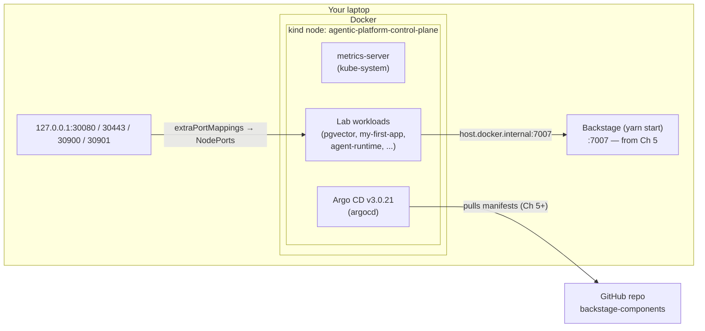
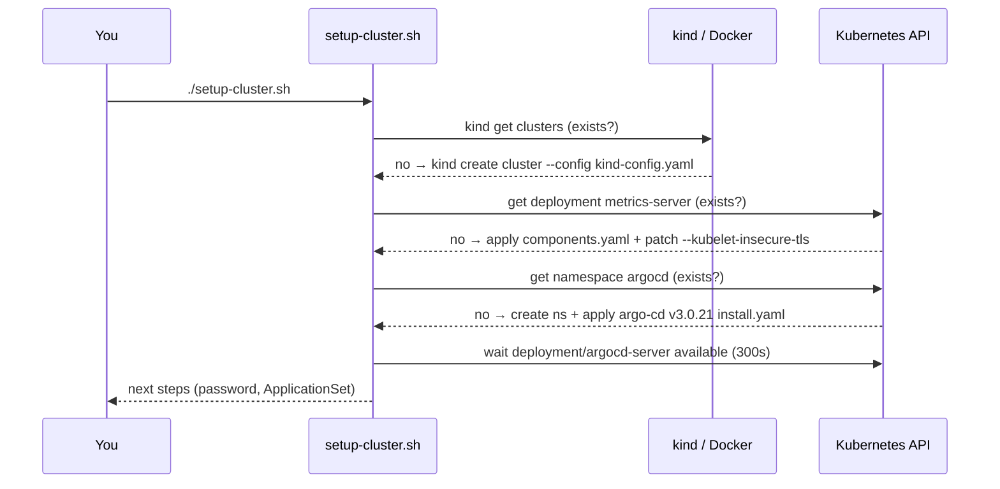

# Lab 0 — Shared Cluster Setup: Deep Dive & Deployment Guide

> **Book:** [*Agentic AI for Platform Engineering*](https://www.oreilly.com/library/view/agentic-ai-for/9781806386659/) — shared prerequisite for every hands-on chapter
> **Lab source:** [`00-cluster-setup/`](../00-cluster-setup/) · **Series index:** [guides/README.md](README.md) · **Next:** [Chapter 4 — Organizational Knowledge](chapter-04-organizational-knowledge.md)

> [!WARNING]
> Learning and experimentation only — see the [repository warning](../README.md). Not a production baseline.

| At a glance | |
|---|---|
| **Builds on** | Nothing — this is the starting point |
| **Feeds into** | Chapters 4, 5, 7, 8 (Chapter 9 runs locally and needs no cluster) |
| **Labs** | One: create, verify, and (eventually) tear down the `agentic-platform` cluster |
| **Approx. time** | 10–20 minutes, mostly image pulls |
| **Cost / credentials** | Free, runs offline after images are pulled. A GitHub token is optional (only for the `verify.sh` GitHub check) |

---

## 1. What you'll build

One local Kubernetes cluster, named `agentic-platform`, that every later lab deploys onto. It is a [kind](https://kind.sigs.k8s.io/) cluster: Kubernetes running as a Docker container on your laptop. Two add-ons are installed on top: **Metrics Server**, so the Chapter 5 web-app template's HorizontalPodAutoscaler works, and **Argo CD `v3.0.21`**, the GitOps engine that Chapters 5, 7, and 8 deploy through.



| Component | Why it exists | Defined in |
|---|---|---|
| kind cluster `agentic-platform` | The substrate everything deploys onto | [`kind-config.yaml`](../00-cluster-setup/kind-config.yaml) |
| Metrics Server (patched with `--kubelet-insecure-tls`) | Serves `metrics.k8s.io` for the HPA in the Chapter 5 template | [`setup-cluster.sh` L43–L55](../00-cluster-setup/setup-cluster.sh#L43-L55) |
| Argo CD `v3.0.21` | The GitOps deploy channel for Chapters 5, 7, and 8 | [`setup-cluster.sh` L57–L71](../00-cluster-setup/setup-cluster.sh#L57-L71) |
| NodePorts `30080/30443/30900/30901` on `127.0.0.1` | Reach in-cluster services from the host without a port-forward | [`kind-config.yaml` L16–L28](../00-cluster-setup/kind-config.yaml#L16-L28) |

---

## 2. Concepts deep dive

### 2.1 One shared, cumulative cluster

The chapters are designed to **accumulate state**: Chapter 5 installs Argo CD wiring and a GitOps repository, Chapter 7 deploys an agent runtime into `agent-platform`, and Chapter 8 hardens that same runtime. Creating a fresh cluster per chapter would throw that away, so the repository convention is: *reuse `agentic-platform`* ([repo README](../README.md#conventions-across-chapters)).

kind runs each Kubernetes node as a Docker container (`agentic-platform-control-plane`). That gives you a real API server, kubelet, and containerd, so manifests behave as they would on EKS. The trade-offs: there is no cloud load balancer, images built on your host are not visible to the cluster until you load them, and networking to your host needs a bridge.

### 2.2 Port mappings: how the host reaches the cluster

[`kind-config.yaml`](../00-cluster-setup/kind-config.yaml#L12-L28) forwards four container ports to `127.0.0.1` on your laptop:

| Host port | Used by |
|---|---|
| `30080`, `30443` | Web apps scaffolded from the Chapter 5 template (for example `my-first-app`) |
| `30900` | Chapter 4 Postgres + pgvector (the RAG vector store) |
| `30901` | Reserved for chapter demos |

A Service of `type: NodePort` with `nodePort: 30900` becomes `localhost:30900` on your machine (see [`pgvector.yaml` L93–L100](../chapter-04/2-rag-pipeline/files/pgvector/pgvector.yaml#L93-L100)). The `listenAddress: "127.0.0.1"` matters: the ports are not exposed to your LAN.

Everything else (Argo CD, Langfuse, the agent runtime, Keycloak) is reached with `kubectl port-forward`. Those services need no entry here.

> [!NOTE]
> Port mappings are fixed when a kind cluster is created. If you change `kind-config.yaml` later, you must delete and recreate the cluster.

### 2.3 Metrics Server and the `--kubelet-insecure-tls` patch

The HPA in the Chapter 5 template reads CPU utilisation from the `metrics.k8s.io` API, which Metrics Server provides by scraping each kubelet. kind's kubelets serve self-signed certificates, so the script appends `--kubelet-insecure-tls` to the Metrics Server container args ([L52–L53](../00-cluster-setup/setup-cluster.sh#L52-L53)).

**In production** you would not skip TLS verification. Use kubelet serving certificates signed by the cluster CA (for example, enable `serverTLSBootstrap` and approve the CSRs), or use the managed Metrics Server add-on on EKS.

### 2.4 Argo CD and the GitOps contract

Argo CD is installed from the upstream manifest pinned to `v3.0.21` ([L66](../00-cluster-setup/setup-cluster.sh#L66)). Nothing is pointed at Git yet. Chapter 5 adds an **ApplicationSet** named `backstage-app-discovery` that watches your `backstage-components` repository ([`argocd-applicationset.yaml`](../chapter-05/1-backstage-setup/files/argocd-applicationset.yaml)).

That establishes the contract that every later chapter, and every agent, has to follow:

```
branch → pull request → human review and merge → Argo CD sync
```

Agents in Chapters 7 and 8 never `kubectl apply` workload changes. They open PRs. That is why Argo CD is installed in Lab 0.

### 2.5 The host bridge: `host.docker.internal`

Backstage runs on your laptop (`yarn start`, port `7007`), not in the cluster. From Chapter 7 on, the agent runtime inside kind calls Backstage at `http://host.docker.internal:7007` (see [`deployment.yaml` L34](../chapter-07/3-gitops-mcp/files/components-repo/agent-platform/k8s/deployment.yaml#L34)). `verify.sh` tests this by launching a throw-away `curlimages/curl` pod ([L86–L87](../00-cluster-setup/verify.sh#L86-L87)).

> [!IMPORTANT]
> Docker Desktop (macOS and Windows) resolves `host.docker.internal` to the host. On Linux with Docker Engine the name usually does not resolve inside kind pods. If the bridge check fails on Linux even while Backstage is running, use the kind network's gateway IP instead (`docker network inspect kind`) and change the `BACKSTAGE_URL` env value in the Chapter 7/8 `agent-runtime` deployment manifests to match.

### 2.6 Getting locally built images into kind

Chapters 7 and 8 build an `agent-runtime` image on your host. kind cannot pull from your local Docker daemon, so the labs **save a single-platform archive and load it** into the node's containerd:

```bash
export KIND_PLATFORM=linux/arm64   # linux/amd64 on Intel/AMD
docker build --platform "$KIND_PLATFORM" -t agent-runtime:0.7.1 ...
docker image save --platform "$KIND_PLATFORM" -o /tmp/agent-runtime.tar agent-runtime:0.7.1
kind load image-archive /tmp/agent-runtime.tar --name agentic-platform
```

(From [`chapter-07/1-strands-runtime/README.md`](../chapter-07/1-strands-runtime/README.md) and [`chapter-08/0-prereqs/README.md`](../chapter-08/0-prereqs/README.md).) Saving one platform per archive avoids kind's multi-platform image import problem. The `ImagePullBackOff` runbook in the Chapter 4 corpus ([`imagepullbackoff.md`](../chapter-04/1-knowledge-corpus/corpus/runbooks/imagepullbackoff.md)) describes what goes wrong when this step is skipped.

### 2.7 Idempotent, read-only-by-default tooling

- [`setup-cluster.sh`](../00-cluster-setup/setup-cluster.sh) checks for existing state before every step, so re-running it is safe. Three environment overrides are available: `CLUSTER_NAME` (default `agentic-platform`), `ARGOCD_VERSION` (default `v3.0.21`), and `SKIP_ARGOCD=1`.
- [`verify.sh`](../00-cluster-setup/verify.sh) deploys nothing (the curl pod is `--rm`). Its GitHub check is a good example of secret hygiene. The token comes from `GITHUB_TOKEN` or from the Kubernetes Secret `argocd/github-creds`. It is sent to `curl` on **stdin** (`--header @-`), so it never appears in the process list ([L128–L130](../00-cluster-setup/verify.sh#L128-L130)), and the variable is unset immediately after use.

---

## 3. Prerequisites

- [ ] **Docker** running ([Docker Desktop](https://docs.docker.com/get-started/get-docker/) on macOS). Give it enough resources for the later chapters: 4+ CPUs and 8 GB RAM is a comfortable baseline once Argo CD, Langfuse, Keycloak, OPA, and the agent runtime are all running.
- [ ] **kind** ([install](https://kind.sigs.k8s.io/docs/user/quick-start/#installation)): `brew install kind`
- [ ] **kubectl** ([install](https://kubernetes.io/docs/tasks/tools/)): `brew install kubectl`
- [ ] **jq** (optional; needed only for the Secret-based GitHub check in `verify.sh`): `brew install jq`
- [ ] Free host ports `30080`, `30443`, `30900`, `30901`

| Env var | Default | Purpose | Used in |
|---|---|---|---|
| `CLUSTER_NAME` | `agentic-platform` | Cluster name (keep the default — later labs hard-code `--name agentic-platform`) | `setup-cluster.sh`, `verify.sh`, `teardown.sh` |
| `ARGOCD_VERSION` | `v3.0.21` | Argo CD manifest version | `setup-cluster.sh` |
| `SKIP_ARGOCD` | `0` | `1` installs only cluster + Metrics Server (enough for Chapter 4) | `setup-cluster.sh` |
| `GITHUB_USERNAME`, `GITHUB_TOKEN` | unset | Optional: check your PAT against `<user>/backstage-components` | `verify.sh` |

---

## 4. Lab 0 — Create and verify the cluster

### Goal

A reachable `kind-agentic-platform` context with Metrics Server serving metrics and all Argo CD pods `Running`.

### How it works



### Deploy

1. Create everything (full install, needed from Chapter 5 onward):

   ```bash
   cd 00-cluster-setup
   ./setup-cluster.sh
   ```

   Doing **only Chapter 4**? You can skip Argo CD and add it later by re-running without the flag:

   ```bash
   SKIP_ARGOCD=1 ./setup-cluster.sh
   ```

2. Get the Argo CD admin password (needed in Chapter 5):

   ```bash
   kubectl -n argocd get secret argocd-initial-admin-secret -o jsonpath="{.data.password}" | base64 -d; echo
   ```

3. (Optional) Open the Argo CD UI in a separate terminal:

   ```bash
   kubectl port-forward svc/argocd-server -n argocd 8080:443
   # https://localhost:8080  (user: admin; accept the self-signed certificate)
   ```

4. **Do not** apply the ApplicationSet yet. It belongs to [Chapter 5, Lab 1](chapter-05-ai-powered-backstage.md) and requires replacing `YOUR_USERNAME` first.

### Verify

```bash
./verify.sh
```

Expected on a fresh cluster:

| Check | Fresh cluster result | When it turns green |
|---|---|---|
| Cluster reachable | ✓ | Now |
| Metrics Server serving | ✓ (or `!` for the first ~30 s) | Now |
| All Argo CD pods Running | ✓ | Now |
| ApplicationSet `backstage-app-discovery` | `!` warning | Chapter 5, Lab 1 |
| Host bridge `host.docker.internal:7007` | `!` warning | When Backstage is running (Chapter 5) |
| GitHub credential | `!` skipped | Once you set `GITHUB_USERNAME`/`GITHUB_TOKEN` or create `argocd/github-creds` |

Warnings (`!`) do not fail the script; only `✗` does. Once Chapter 5 is in place, run the stricter variant:

```bash
GITHUB_USERNAME=your-username GITHUB_TOKEN=github_pat_... ./verify.sh
# or, to require the Secret Argo CD uses:
./verify.sh --github-secret argocd/github-creds
```

A few direct checks:

```bash
kubectl config current-context            # kind-agentic-platform
kubectl get nodes -o wide                 # 1 node, Ready
kubectl top nodes                         # numbers, not "Metrics API not available"
kubectl -n argocd get pods                # all Running
```

### Explore further

1. **See the node is "just a container":** `docker ps --filter name=agentic-platform` and `docker exec agentic-platform-control-plane crictl images`. Run the second command again after a Chapter 7 `kind load` to watch your image appear.
2. **Prove idempotence:** run `./setup-cluster.sh` a second time. Every step should print `✓ ... already ...`.
3. **Follow the metrics path:** `kubectl get apiservice v1beta1.metrics.k8s.io` shows the aggregated API Metrics Server registers. `kubectl -n kube-system get deploy metrics-server -o jsonpath='{.spec.template.spec.containers[0].args}'` shows the TLS patch.
4. **Explore Argo CD's API surface:** `kubectl get crd | grep argoproj`. You will create an `ApplicationSet` in Chapter 5 and `Application`s in Chapter 7.

### Troubleshooting

| Symptom | Likely cause | Fix |
|---|---|---|
| `ERROR: 'kind' not found on PATH` | Tool missing | Install it (`brew install kind kubectl`) |
| `Cannot connect to the Docker daemon` | Docker Desktop not running | Start Docker, then re-run the script |
| `port is already allocated` during create | Something on the host uses 30080/30443/30900/30901 | Free the port (`lsof -i :30900`), or edit `kind-config.yaml` (and the chapters that rely on that port) before creating the cluster |
| `kubectl top nodes` → `Metrics API not available` | Metrics Server still starting, or patch missing | Wait 30–60 s; check `kubectl -n kube-system logs deploy/metrics-server` for x509 errors |
| `timed out waiting for the condition` on `argocd-server` | Slow image pulls | Check `kubectl -n argocd get pods`; once pulls finish, re-run the script (it resumes) |
| Commands hit the wrong cluster | Another kube context is active | `kubectl config use-context kind-agentic-platform` (`verify.sh` also switches it) |
| Host bridge warning while Backstage **is** running | Linux Docker Engine, or Backstage not on `7007` | See §2.5; confirm `curl localhost:7007/api/catalog/entities` works on the host first |
| GitHub check `HTTP 401` / `404` | Expired PAT, or the PAT does not include `backstage-components` | Regenerate the fine-grained PAT with access to that repository (Chapter 5, Lab 1) |

> [!NOTE]
> **Repo notes.** (1) `setup-cluster.sh` installs Metrics Server from `releases/latest`, so it is not pinned. If a future release misbehaves on kind, pin a specific version from the [metrics-server releases](https://github.com/kubernetes-sigs/metrics-server/releases). (2) Some comments still say "Chapters 4, 5, and 6" (`00-cluster-setup/README.md`, `kind-config.yaml`). The old Chapter 6 is now Chapter 7, and the cluster is used by Chapters 4, 5, 7, and 8.

---

## 5. Using Amazon EKS instead of kind

The repository supports EKS as a substitute ([README](../00-cluster-setup/README.md)): skip `kind`, then install Metrics Server and Argo CD on your cluster (EKS offers both as managed options — see [Getting started with EKS](https://docs.aws.amazon.com/eks/latest/userguide/getting-started.html) and [EKS capabilities](https://docs.aws.amazon.com/eks/latest/userguide/capabilities.html)). Plan for these differences:

- **No `127.0.0.1` NodePorts.** Reach pgvector (Chapter 4) and web apps through `kubectl port-forward` or a load balancer.
- **No `host.docker.internal`.** The in-cluster agent (Chapters 7–8) must reach Backstage on a routable address. Either host Backstage somewhere the cluster can reach, or deploy it into the cluster.
- **No `kind load`.** Push `agent-runtime` images to a registry (for example Amazon ECR) and update the image references in the manifests.
- **Bedrock auth.** Prefer IAM roles for service accounts or EKS Pod Identity over static keys in Secrets.

---

## 6. End state & what carries forward

- `kind-agentic-platform` context, Metrics Server, and Argo CD (unless `SKIP_ARGOCD=1`).
- Chapter 4 adds `pgvector` (port 30900). Chapter 5 adds the ApplicationSet, the `argocd/github-creds`-style repository credential, and `my-first-app`. Chapter 7 adds `agent-platform` and `langfuse`. Chapter 8 adds OPA and Keycloak in `agent-platform`.

## 7. Clean up / reset

```bash
cd 00-cluster-setup
./teardown.sh
```

This deletes the kind cluster and **everything inside it**: Argo CD, apps, the agent runtime, Langfuse, pgvector data, and Keycloak. It does **not** touch your Backstage app on the host, your GitHub repositories, local images, or Python virtualenvs. To reclaim disk space from images you built, run `docker image rm agent-runtime:<tag>`.

To rebuild after a teardown, re-run `./setup-cluster.sh`, then redo each chapter's deploy steps. Argo CD re-syncs Git-managed apps once the ApplicationSet and credentials are re-applied, but images loaded with `kind load` must be loaded again.

---

## 8. Further reading

**Official docs**
- [kind — Quick Start](https://kind.sigs.k8s.io/docs/user/quick-start/): cluster creation, loading images, and multi-node setups.
- [kind — Configuration](https://kind.sigs.k8s.io/docs/user/configuration/): `extraPortMappings` and the other fields used in `kind-config.yaml`.
- [Kubernetes Metrics Server](https://github.com/kubernetes-sigs/metrics-server): what `--kubelet-insecure-tls` bypasses and the secure alternatives.
- [HorizontalPodAutoscaler walkthrough](https://kubernetes.io/docs/tasks/run-application/horizontal-pod-autoscale-walkthrough/): how the Chapter 5 HPA consumes these metrics.
- [Argo CD — Getting Started](https://argo-cd.readthedocs.io/en/stable/getting_started/): installation, the admin password, and the UI.
- [Argo CD — ApplicationSet](https://argo-cd.readthedocs.io/en/stable/operator-manual/applicationset/): the controller Chapter 5 relies on.

**Articles & principles**
- [OpenGitOps principles](https://opengitops.dev/): the four principles behind "Git is the source of truth; the cluster pulls".
- [CNCF Platforms White Paper](https://tag-app-delivery.cncf.io/whitepapers/platforms/): what a platform is and why the labs build one capability at a time.

## 9. Book reference

*Agentic AI for Platform Engineering* — Tiago Miguel Reichert, Lucas Soriano Alves Duarte, Jaime Nagase (Packt, 2026, ISBN 9781806386659). The repo README uses the working title *AI-Driven Platform Engineering*; it is the same book.

- O'Reilly: https://www.oreilly.com/library/view/agentic-ai-for/9781806386659/
- Amazon: https://www.amazon.com/Agentic-Platform-Engineering-Rethinking-autonomous/dp/1806386658
- Packt: https://www.packtpub.com/en-us/search?q=Agentic+AI+for+Platform+Engineering
- Code: https://github.com/PacktPublishing/Agentic-AI-for-Platform-Engineering

Lab 0 is not tied to a single book section. It is the shared environment for the hands-on parts of Chapters 4, 5, 7, and 8.
