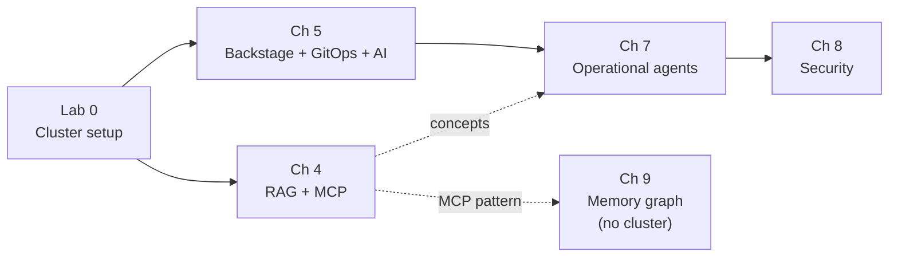
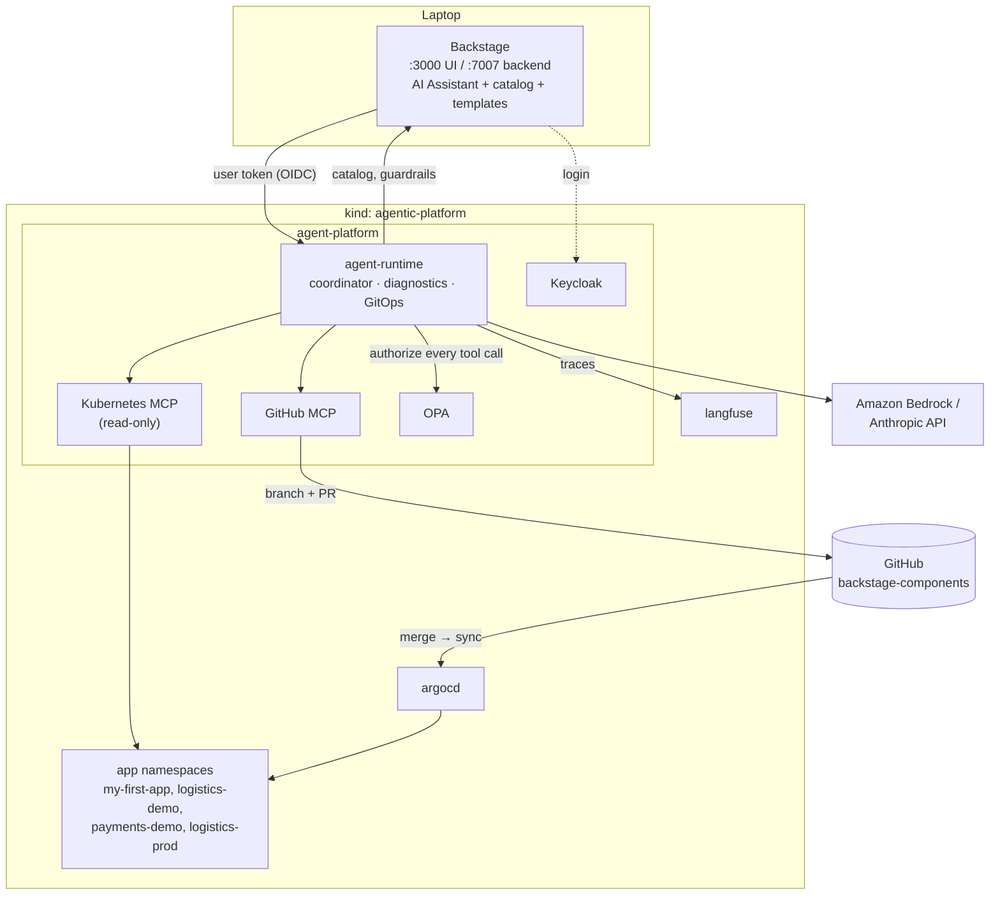

# Lab Guide Series — Agentic AI for Platform Engineering

A chapter-by-chapter **deep dive and deployment guide** for every lab in this repository. Each guide explains *why* the lab is built the way it is (concepts, design trade-offs, the code that implements them) and gives you a tested runbook to deploy, verify, explore, troubleshoot, and tear it down.

> [!WARNING]
> **For learning and experimentation only.** Like the labs themselves, these guides describe reference implementations with intentionally simplified credentials, IAM, networking, and policies. Do not treat them as a production baseline. See the [repository warning](../README.md).

## The book

*Agentic AI for Platform Engineering: Rethinking developer platforms with agentic AI, RAG, MCP, and governed autonomous operations* — Tiago Miguel Reichert, Lucas Soriano Alves Duarte, Jaime Nagase (Packt, 2026, ISBN 9781806386659).

| Where | Link |
|---|---|
| O'Reilly Learning | https://www.oreilly.com/library/view/agentic-ai-for/9781806386659/ |
| Amazon | https://www.amazon.com/Agentic-Platform-Engineering-Rethinking-autonomous/dp/1806386658 |
| Packt | https://www.packtpub.com/en-us/search?q=Agentic+AI+for+Platform+Engineering |
| Companion code (this repo) | https://github.com/PacktPublishing/Agentic-AI-for-Platform-Engineering |

> [!NOTE]
> The repository README and some files use the book's working title, *AI-Driven Platform Engineering* (Packt product code `B34160`). It is the same book.

These guides **complement** the book and the lab READMEs. They do not replace them. The book carries the full argument; the lab READMEs remain the source of truth for exact steps. Where a guide found a gap or a bug in a lab, it says so in a `[!NOTE]` with a workaround.

---

## Guides

| # | Guide | Book chapter | What you build | Approx. time* | Needs |
|---|---|---|---|---|---|
| 0 | [Shared cluster setup](00-cluster-setup.md) | Prerequisite for all | kind cluster `agentic-platform`, Metrics Server, Argo CD v3.0.21 | 15–20 min | Docker, kind, kubectl |
| 4 | [Organizational knowledge: RAG + MCP](chapter-04-organizational-knowledge.md) | Ch 4 — *Driving Platform Intelligence with Organizational Knowledge* | Knowledge corpus → pgvector RAG API; a live-cluster MCP server | 1–2 h | Python 3.11+; LLM optional (retrieval-only mode works without one) |
| 5 | [AI-powered Backstage](chapter-05-ai-powered-backstage.md) | Ch 5 — *Building an AI-Powered Backstage Platform* | Backstage + GitOps template, AI chat assistant, catalog actions, kubectl actions | 2–4 h | Node.js 22, Yarn 4, GitHub PAT, Bedrock (or OpenAI) |
| 7 | [Operational agents & collaboration](chapter-07-operational-agents.md) | Ch 7 — *Operational Agents and Collaboration* | Strands runtime with coordinator, diagnostics, and GitOps agents; Kubernetes and GitHub MCP; Backstage chat; Langfuse | 3–5 h | Ch 5 state, GitHub PAT + `gh`, Bedrock or Anthropic API |
| 8 | [Security in practice](chapter-08-security-in-practice.md) | Ch 8 — *Security in Practice* | Guardrails + approved MCP catalog, OPA authorization, Keycloak identity, tenant isolation | 3–5 h | Ch 7 state, same credentials |
| 9 | [Future directions: living memory graph](chapter-09-future-directions.md) | Ch 9 — *Future Directions* | A PR-extensible knowledge graph served over MCP | 20–40 min | Python 3.10+; MCP host optional |

\* Rough estimates for a first run, including image pulls and builds. Your mileage will vary.

Chapters 1–3 and 6 of the book have no labs in this repository.

## Learning path



- **Chapter 4 stands alone.** `SKIP_ARGOCD=1 ./setup-cluster.sh` is enough.
- **Chapters 5 → 7 → 8 are cumulative.** Each one modifies the Backstage app, the `backstage-components` GitOps repository, and the cluster left by the previous chapter. Do them in order and don't tear down in between.
- **Chapter 9 runs on your laptop** with no cluster.

## What the platform looks like at the end of Chapter 8



---

## Global prerequisites

### Tools

| Tool | Needed for | Notes |
|---|---|---|
| Docker (Docker Desktop on macOS) | All cluster chapters | Allocate 4+ CPUs / 8 GB RAM by Chapter 7–8 |
| kind, kubectl | All cluster chapters | `brew install kind kubectl` |
| jq, curl | Lab 0 verify, Ch 7–8 | `brew install jq` |
| Python 3.11+ | Ch 4, Ch 9 (Ch 7–8 build Python images in Docker) | READMEs call `python3.11`; any compatible `python3` works. See the per-chapter notes on 3.13/3.14 |
| Node.js **22.x** + Yarn **4.x** (Corepack) | Ch 5, 7, 8 (Backstage) | `isolated-vm` requires Node 22; Backstage is created with `npx @backstage/create-app@0.7.9` |
| Git + GitHub CLI (`gh`) | Ch 5, 7, 8 | PR-based GitOps flow |
| AWS CLI | When using Bedrock | `aws sts get-caller-identity` must succeed |

### Accounts and credentials

| Credential | Chapters | How it's used |
|---|---|---|
| GitHub account + fine-grained PAT scoped to `backstage-components` | 5, 7, 8 | Backstage scaffolder, Argo CD repo access, the GitHub MCP server (PRs) |
| Amazon Bedrock with Claude model access (default) | 4 (optional), 5, 7, 8 | Generation in the RAG API, the GenAI plugin, and the Strands agents |
| Anthropic API key (alternative) | 4, 7, 8 | Set `LLM_PROVIDER=anthropic` (Ch 4) or the runtime Secret (Ch 7–8) |
| OpenAI (alternative) | 5 | Supported by the GenAI plugin |

Keep credentials in environment variables or Kubernetes Secrets, as the labs do. Never commit them to `backstage-components`.

### Local endpoints you will use

| Endpoint | What | Chapter |
|---|---|---|
| `localhost:30900` | Postgres + pgvector (NodePort) | 4 |
| `localhost:8000` | RAG API (`uvicorn`) | 4 |
| `localhost:3000` / `localhost:7007` | Backstage frontend / backend | 5, 7, 8 |
| `localhost:8080` | Argo CD UI (`port-forward 8080:443`) **or** a scaffolded app (`port-forward 8080:80`) — not both at once | 5 |
| `localhost:18080` | `agent-runtime` (`port-forward 18080:80`) | 7, 8 |
| `localhost:13000` | Langfuse UI | 7 (Lab 5) |
| `localhost:18083` | Keycloak | 8 (Labs 3–4) |

---

## Conventions used across all chapters

- **One cluster:** reuse `agentic-platform`; never create one per chapter.
- **GitOps contract:** workload changes go *branch → pull request → human review and merge → Argo CD*. Agents propose; humans merge.
- **Least privilege by default:** Kubernetes access from agents is read-only; credentials come from env vars or Secrets; Chapter 8 evaluates identity and policy before any tool executes.
- **Images into kind:** build with `--platform "$KIND_PLATFORM"` (`linux/arm64` on Apple Silicon, `linux/amd64` on Intel/AMD), `docker image save`, then `kind load image-archive ... --name agentic-platform`. See [Lab 0 §2.6](00-cluster-setup.md#26-getting-locally-built-images-into-kind).

## How each guide is organized

1. **What you'll build:** an end-state diagram and a lab table
2. **Concepts deep dive:** the ideas, mapped to code with line-anchored links
3. **Prerequisites:** tools, credentials, carried-over state, env vars
4. **One section per lab:** Goal · How it works · Deploy · Verify · Explore further · Troubleshooting
5. **End-to-end check & what carries forward**
6. **Clean up / reset**
7. **Further reading:** official docs, articles and blogs, specs and papers
8. **Book reference**

## Known issues found while writing these guides

Each item is explained in context, with its workaround, in the linked guide.

| Where | Issue | Workaround |
|---|---|---|
| Ch 9 | **Blocking.** `requirements.txt` has `mcp[cli]>=1.2.0`, which now installs MCP SDK 2.x; the server crashes with `No module named 'mcp.server.fastmcp'` (reproduced) | `pip install 'mcp[cli]>=1.2.0,<2'` — [details](chapter-09-future-directions.md#3-prerequisites) |
| Ch 9 | `client_demo.py` prints list results as an escaped string (cosmetic) | Read `structuredContent["result"]` — [details](chapter-09-future-directions.md#verify) |
| Ch 4, 9 | READMEs call `python3.11`, which may not exist on your machine | Any `python3` ≥ 3.11 works; Ch 4 Lab 2 deps and Ch 9 were verified on Python 3.14 |
| Ch 4 | The README's sample `pod_reasons` shows only `CrashLoopBackOff`; real output usually also contains `Error` (from `last_state`) | Expected — [details](chapter-04-organizational-knowledge.md#lab-3--an-mcp-server-over-the-live-cluster) |
| Ch 4 | `LLM_PROVIDER=none` returns sources and scores, not the chunk text the prereqs README suggests | Expected; query pgvector directly to see chunks — [details](chapter-04-organizational-knowledge.md#lab-2--a-local-rag-pipeline) |
| Ch 4 | The RAG API reads env vars only at startup | Restart `uvicorn` after changing `LLM_PROVIDER` and other variables |
| Ch 5 | Copy commands use `../ai-driven-platform-engineering/...` paths | Export `BOOK_REPO` to your clone — [details](chapter-05-ai-powered-backstage.md#3-prerequisites) |
| Ch 5 | Argo CD UI and the app port-forward both use local port `8080` | Forward the app to `8081` — [details](chapter-05-ai-powered-backstage.md#lab-1--setting-up-backstage-with-gitops) |
| Ch 5 | The template's **Namespace** must equal the app name, or Argo CD sync fails (the ApplicationSet derives the namespace from the folder) | Use the app name as the namespace |
| Ch 5 | `argocd/github-creds` is described as optional for public repos, but Chapter 7 reads it | Always create it |
| Lab 0 | Metrics Server is installed from `releases/latest` (unpinned); some comments still say "Chapter 6" | Pin a release if it breaks; Chapter 6 → 7 — [details](00-cluster-setup.md#troubleshooting) |
| Ch 7, 8 | `BOOK_REPO` examples use `.../ai-driven-platform-engineering-book` | Point it at your actual clone (for example `.../Agentic-AI-for-Platform-Engineering`) |
| Ch 7, 8 | Image loading uses `docker image save --platform`, which needs Docker Engine 28+ | Upgrade Docker, or fall back to `kind load docker-image` — [details](chapter-07-operational-agents.md#3-prerequisites) |
| Ch 7 | Guard snippets end in `exit 1`, which closes your interactive shell when they fire | Wrap them in `( … )` or `bash -c '…'` — [details](chapter-07-operational-agents.md#lab-3--gitops-changes-and-agent-collaboration) |
| Ch 7 | Editing `files/skills/.../SKILL.md` has no effect at runtime | Edit the ConfigMap copy in your components repo; that is what the runtime reads |
| Ch 7 | The Lab 4 adapter imports `@aws/genai-plugin-for-backstage-node`, which Chapter 5 does not install directly | Add the package if the backend reports `Cannot find module` — [details](chapter-07-operational-agents.md#lab-4--collaboration-in-the-existing-backstage-chat) |
| Ch 8 | Lab 1 needs Backstage started with `BACKSTAGE_SERVICE_TOKEN` and the `agent-backstage-read` Secret from Chapter 7; the READMEs only say "Chapter 7 credentials" | Export the token before `yarn start` — [details](chapter-08-security-in-practice.md#3-prerequisites-lab-0) |
| Ch 8 | The `sed` edits to `app-config.yaml` and `App.tsx` do nothing if the expected anchor lines are missing | Check with `git diff` after each edit — [details](chapter-08-security-in-practice.md#4-lab-1--guardrails-and-the-approved-mcp-catalog) |
| Ch 8 | `common/README.md` says audit records carry a catalog digest, but once OPA is enabled (Labs 2–4) they don't | Expected with the current code |
| Ch 8 | `TENANT_ISOLATION` and `MEMORY_FILE` are set in the Deployments but never read; memory goes to `SCOPED_MEMORY_DIR` | Ignore those two variables |
| Ch 8 | The Chapter 7 ClusterRole lets the Kubernetes MCP server read every namespace; isolation relies on runtime checks and OPA | Fine for the lab; scope RBAC per tenant in production |

## Tear everything down

```bash
cd 00-cluster-setup && ./teardown.sh        # deletes the cluster and everything in it
```

This does **not** remove: the Backstage app on your host, your `backstage-components` GitHub repository and its PRs, local Docker images (`docker image rm agent-runtime:<tag>`), Python virtualenvs (`.venv/` folders, git-ignored), or MCP host registrations you added (for example `claude mcp remove living-memory-graph`). Each chapter guide has a narrower reset section.

## General further reading

- [CNCF Platforms White Paper](https://tag-app-delivery.cncf.io/whitepapers/platforms/): the platform-as-a-product framing behind the whole series.
- [Model Context Protocol](https://modelcontextprotocol.io/): the protocol used from Chapter 4 onward.
- [Anthropic — Building effective agents](https://www.anthropic.com/engineering/building-effective-agents): workflows vs agents, and orchestrator–worker patterns (Chapter 7).
- [Anthropic — Effective context engineering for AI agents](https://www.anthropic.com/engineering/effective-context-engineering-for-ai-agents): why curated context matters (Chapters 4 and 9).
- [OWASP GenAI Security Project — Top 10 for LLM Applications](https://genai.owasp.org/llm-top-10/): the threat model behind Chapter 8.
- [OpenGitOps](https://opengitops.dev/): the principles behind the PR → merge → Argo CD contract.
