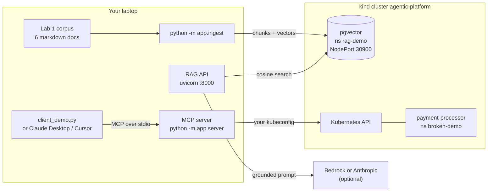
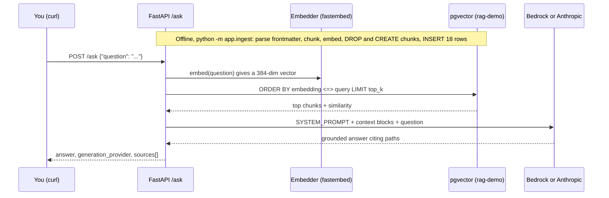
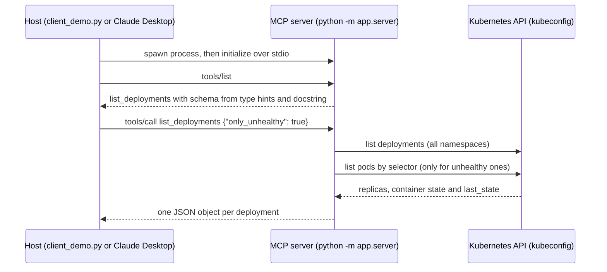

# Chapter 4 — Driving Platform Intelligence with Organizational Knowledge: Deep Dive & Deployment Guide

> **Book:** [*Agentic AI for Platform Engineering*](https://www.oreilly.com/library/view/agentic-ai-for/9781806386659/) — Chapter 4, *Driving Platform Intelligence with Organizational Knowledge*
> **Lab source:** [`chapter-04/`](../chapter-04/) · **Series index:** [guides/README.md](README.md) · **Previous:** [00 — Cluster setup](00-cluster-setup.md) · **Next:** [Chapter 5 — AI-powered Backstage](chapter-05-ai-powered-backstage.md)

> [!WARNING]
> Learning and experimentation only. See the [repository warning](../README.md). This is not a production baseline.

| At a glance | |
|---|---|
| **Builds on** | [00 — Cluster setup](00-cluster-setup.md). You need the kind cluster `agentic-platform`. ArgoCD is optional (`SKIP_ARGOCD=1` is enough). |
| **Feeds into** | Concepts only. The RAG and MCP ideas come back in Chapter 5 (catalog and `kubectl` actions in Backstage) and Chapter 7 (agents on official MCP servers). No Chapter 4 resource is reused later. |
| **Labs** | 0 Prerequisites · 1 Knowledge corpus · 2 Local RAG pipeline · 3 MCP server over the live cluster |
| **Approx. time** | 1.5–2.5 hours, including the first model download |
| **Cost / credentials** | Runs free on your laptop. Embeddings are local. Generation is optional and needs either Amazon Bedrock or an Anthropic API key, which costs a little per question. |

---

## 1. What you'll build

Chapter 4 rests on one claim: **a model is only as good as the context you give it.** Here you take a small body of organizational knowledge (runbooks, a postmortem and blueprints) and make it usable by AI in two ways:

- **RAG (Lab 2)** embeds the durable documents into Postgres + pgvector. It answers "how was this solved before?" and returns the sources it used.
- **MCP (Lab 3)** exposes a `list_deployments` tool that queries the live cluster. It answers "what is true right now?"

When you finish, you will have run both, compared them, and fed the output of one into the other.



| Lab | What it adds | Key artifacts |
|---|---|---|
| 0 — Prerequisites | Confirms the cluster, Python 3.11+ and optional LLM credentials. Deploys nothing. | [0-prereqs/README.md](../chapter-04/0-prereqs/README.md) |
| 1 — Knowledge corpus | 6 structured markdown docs with an owner, a type and a consistent layout | [corpus/](../chapter-04/1-knowledge-corpus/corpus/) |
| 2 — Local RAG pipeline | pgvector in the cluster, plus local ingestion and a `/ask` API that returns cited sources | [pgvector.yaml](../chapter-04/2-rag-pipeline/files/pgvector/pgvector.yaml), [rag/app/](../chapter-04/2-rag-pipeline/files/rag/app/) |
| 3 — MCP server | A FastMCP server over stdio with a `list_deployments` tool against the live cluster, plus a deliberately broken app | [server.py](../chapter-04/3-mcp-server/files/mcp/app/server.py), [k8s.py](../chapter-04/3-mcp-server/files/mcp/app/k8s.py), [broken-app.yaml](../chapter-04/3-mcp-server/files/broken-app.yaml) |

Only the stateful part, Postgres, runs in the cluster. The RAG API and the MCP server run on your host in virtualenvs. You don't build images or run `kind load` in this chapter ([0-prereqs/README.md:35-43](../chapter-04/0-prereqs/README.md#L35-L43)).

---

## 2. Concepts deep dive

### 2.1 A structured corpus is the foundation

**What it is.** Every document starts with the same frontmatter: `type`, `title`, `owner` and `tags` ([1-knowledge-corpus/README.md:28-41](../chapter-04/1-knowledge-corpus/README.md#L28-L41)). The corpus mixes three kinds of knowledge:

- **Runbooks:** how to handle X.
- **Postmortems:** what went wrong once.
- **Blueprints:** the approved way to do something.

**Why it matters.** Consistent metadata lets every retrieved chunk say where it came from and who stands behind it. The RAG API returns `owner` and `doc_type` with every source. The corpus also links documents together. The [postmortem](../chapter-04/1-knowledge-corpus/corpus/postmortems/2026-03-payment-processor-outage.md) points back to the [CrashLoopBackOff runbook](../chapter-04/1-knowledge-corpus/corpus/runbooks/crashloopbackoff.md), which is the knowledge flow described in §4.6.

**Where it lives in code.** [`parse_frontmatter`](../chapter-04/2-rag-pipeline/files/rag/app/ingest.py#L19-L37) is a tiny parser for flat `key: value` lines that avoids a YAML dependency. [`load_corpus`](../chapter-04/2-rag-pipeline/files/rag/app/ingest.py#L57-L77) keeps only `type`, `title` and `owner` per chunk. `tags`, and extra keys such as the postmortem's `incident_date` and `severity`, are parsed but not stored.

**Trade-offs and production.** The schema is a convention, so nothing enforces it. A production setup would:

- validate frontmatter in CI with a schema;
- add `last_reviewed` or `expires` fields to fight staleness;
- store tags as an array column so retrieval can filter on them.

The `owner` field is what makes knowledge accountable. Chapter 5 gets the same effect from the Backstage catalog's `spec.owner`.

### 2.2 Chunking: paragraph packing with overlap

[`chunk_text`](../chapter-04/2-rag-pipeline/files/rag/app/ingest.py#L40-L54) works in three steps:

1. Split the body on blank lines into paragraphs.
2. Pack paragraphs into chunks of about `CHUNK_CHARS=900` characters.
3. Start each new chunk with the last `CHUNK_OVERLAP=150` **characters** of the previous one.

On the shipped corpus this produces **18 chunks from 6 documents**. Per file: standard-service 3, tagging-and-labels 2, postmortem 4, and each runbook 3.

Things to notice:

- **The overlap is character-based,** so a chunk can start mid-word. That's fine for embeddings, but it shows up when you read raw chunks.
- **Blank lines inside code fences split them.** A ```` ```bash ```` block that contains blank lines can land in two chunks. Heading-aware or markdown-aware splitters avoid this.
- **Chunks carry no document context.** A chunk from the OOMKilled runbook doesn't say "OOMKilled runbook" unless that phrase appears in the text. Anthropic's [Contextual Retrieval](https://www.anthropic.com/engineering/contextual-retrieval) technique fixes exactly this by prepending a short, document-aware summary to each chunk before embedding.

### 2.3 Embeddings: local fastembed versus Amazon Titan

Both providers implement one small interface: `.embed(texts)` and `.dimension` ([embeddings.py:18-21](../chapter-04/2-rag-pipeline/files/rag/app/embeddings.py#L18-L21)).

| | `local` (default) | `bedrock` |
|---|---|---|
| Model | `BAAI/bge-small-en-v1.5` via [fastembed](https://github.com/qdrant/fastembed) | `amazon.titan-embed-text-v2:0` |
| Dimension | 384, probed at startup ([L31-L33](../chapter-04/2-rag-pipeline/files/rag/app/embeddings.py#L31-L33)) | 1024, hardcoded as the Titan v2 default ([L47](../chapter-04/2-rag-pipeline/files/rag/app/embeddings.py#L47)) |
| Credentials | None. Downloads about 100 MB on first use. | AWS credentials with Bedrock access |
| Calls | Batched on CPU | One `invoke_model` per text ([L49-L58](../chapter-04/2-rag-pipeline/files/rag/app/embeddings.py#L49-L58)) |

**Design detail.** The store sizes its column from `embedder.dimension` ([ingest.py:94-97](../chapter-04/2-rag-pipeline/files/rag/app/ingest.py#L94-L97)), and every ingest drops the table first ([store.py:52-54](../chapter-04/2-rag-pipeline/files/rag/app/store.py#L52-L54)). Switching providers therefore just works at ingest time.

> [!IMPORTANT]
> The API embeds each question with whatever `EMBEDDINGS_PROVIDER` is set **when the API starts**. Ingest and query must use the same provider. Otherwise pgvector rejects the query because the vector dimensions differ.

### 2.4 The vector store: pgvector, cosine distance, exact search

- **Schema.** One table, `chunks`, holds metadata, content and an `embedding VECTOR(<dimension>)` column ([store.py:35-49](../chapter-04/2-rag-pipeline/files/rag/app/store.py#L35-L49)). [`connect`](../chapter-04/2-rag-pipeline/files/rag/app/store.py#L28-L32) creates the extension if needed and registers the vector type adapter.
- **Search.** `ORDER BY embedding <=> %s::vector LIMIT k` ([store.py:72-89](../chapter-04/2-rag-pipeline/files/rag/app/store.py#L72-L89)):
  - `<=>` is pgvector's cosine-distance operator, and the reported `score` is `1 - distance`.
  - The explicit `::vector` cast is needed because psycopg sends a Python list as a Postgres array.
- **No index.** With 18 rows, a sequential scan is instant. At real scale you would add an HNSW or IVFFlat index; the [pgvector README](https://github.com/pgvector/pgvector) has the trade-offs. Note that the index would be lost on every re-ingest here, because ingest drops the table.
- **Deployment.** [pgvector.yaml](../chapter-04/2-rag-pipeline/files/pgvector/pgvector.yaml) is a single `pgvector/pgvector:pg16` replica with a 1 Gi PVC. A demo-only Secret holds the credentials `rag` / `ragpassword` ([L11-L21](../chapter-04/2-rag-pipeline/files/pgvector/pgvector.yaml#L11-L21)). A NodePort Service on `30900` ([L85-L100](../chapter-04/2-rag-pipeline/files/pgvector/pgvector.yaml#L85-L100)) is forwarded to `localhost:30900` by [kind-config.yaml](../00-cluster-setup/kind-config.yaml#L23-L26).

**Production differences:**

- a managed Postgres, or an operator with backups;
- secrets from a secret manager;
- an ANN index;
- metadata filters in the `WHERE` clause, such as `doc_type` or `owner`;
- often hybrid keyword + vector search.

### 2.5 Grounded generation: the prompt is the contract

[`SYSTEM_PROMPT`](../chapter-04/2-rag-pipeline/files/rag/app/llm.py#L18-L26) tells the model to:

- answer **only** from the supplied context;
- say plainly when the context does not contain the answer;
- cite the source paths it used.

Each retrieved chunk goes into the prompt with a header line, `[source: … | type: … | owner: …]` ([llm.py:29-37](../chapter-04/2-rag-pipeline/files/rag/app/llm.py#L29-L37)). Generation runs at `temperature 0.0` with `LLM_MAX_TOKENS=1024`.

The [`/ask` handler](../chapter-04/2-rag-pipeline/files/rag/app/api.py#L68-L90) chains the steps: embed the question, then search, then generate, then return `answer` together with `sources`. The `sources` array is the audit trail.

**Limitations worth knowing:**

- **There is no relevance threshold.** The top-k chunks are always passed to the model, even for an off-topic question. Refusing in that case depends entirely on the prompt.
- **`sources` carries metadata only.** It holds path, type, owner and score, but not the chunk text ([api.py:43-55](../chapter-04/2-rag-pipeline/files/rag/app/api.py#L43-L55)). To read the retrieved text, query Postgres directly (see step 3 of *Verify* in [Lab 2](#lab-2--a-local-rag-pipeline)).

### 2.6 Swapping LLM providers

`LLM_PROVIDER` takes `auto`, `bedrock`, `anthropic` or `none` ([settings.py:39-46](../chapter-04/2-rag-pipeline/files/rag/app/settings.py#L39-L46)).

`auto` ([llm.py:40-48](../chapter-04/2-rag-pipeline/files/rag/app/llm.py#L40-L48)) picks:

1. **Bedrock** if `AWS_ACCESS_KEY_ID`, `AWS_PROFILE` or `AWS_CONTAINER_CREDENTIALS_RELATIVE_URI` is set;
2. otherwise **Anthropic** if `ANTHROPIC_API_KEY` is set;
3. otherwise `none`, which is retrieval-only.

The two providers use different APIs with the same prompt:

| Provider | API | Code | Default model |
|---|---|---|---|
| Bedrock | Converse API | [llm.py:51-61](../chapter-04/2-rag-pipeline/files/rag/app/llm.py#L51-L61) | `us.anthropic.claude-sonnet-4-5-20250929-v1:0`, a US cross-region inference profile |
| Anthropic | Messages API | [llm.py:64-75](../chapter-04/2-rag-pipeline/files/rag/app/llm.py#L64-L75) | `claude-sonnet-4-5-20250929` |

> [!NOTE]
> `Settings` reads environment variables once, when the module is imported ([settings.py:23-53](../chapter-04/2-rag-pipeline/files/rag/app/settings.py#L23-L53)). **Restart `uvicorn` after you change any variable.**
>
> Also, `auto` does not notice a default profile in `~/.aws/credentials`, or an SSO session, unless `AWS_PROFILE` is exported. Set `LLM_PROVIDER` explicitly, as the lab README does.

### 2.7 MCP server design

The server ([server.py](../chapter-04/3-mcp-server/files/mcp/app/server.py)) is about 40 lines:

- `FastMCP("platform-cluster")` creates the server.
- One `@mcp.tool()` function, `list_deployments(namespace, only_unhealthy)`, is the only tool. Its **type hints become the tool's input schema** and its **docstring becomes the description the model reads**.
- `mcp.run(transport="stdio")` serves it over stdio ([L40-L43](../chapter-04/3-mcp-server/files/mcp/app/server.py#L40-L43)). The host launches the process and speaks JSON-RPC over stdin and stdout.

> [!TIP]
> On a stdio server, stdout belongs to the protocol. Never `print()` from server code. Log to stderr instead.

The Kubernetes logic lives separately in [k8s.py](../chapter-04/3-mcp-server/files/mcp/app/k8s.py):

- **Health rule:** `healthy = desired > 0 and ready >= desired` ([L82](../chapter-04/3-mcp-server/files/mcp/app/k8s.py#L82)). A deployment scaled to 0 therefore counts as *unhealthy*. You'll explore that in Lab 3.
- **Ownership:** read from the `owner` label ([L83](../chapter-04/3-mcp-server/files/mcp/app/k8s.py#L83)). This is the [tagging blueprint](../chapter-04/1-knowledge-corpus/corpus/blueprints/tagging-and-labels.md) paying off in live data.
- **Handling `last_state`** ([L43-L59](../chapter-04/3-mcp-server/files/mcp/app/k8s.py#L43-L59)). A crash-looping container cycles waiting → running → terminated within seconds, so reading only the current state misses the failure reason about half the time. The function reads both `state` and `last_state`, and collects waiting *and* terminated reasons. Pods are only inspected for unhealthy deployments ([L86-L91](../chapter-04/3-mcp-server/files/mcp/app/k8s.py#L86-L91)), so healthy clusters cost one list call.
- **Identity:** [`config.load_kube_config()`](../chapter-04/3-mcp-server/files/mcp/app/k8s.py#L35-L40) means the tool runs with **your** kubeconfig's current context and permissions. The tool only reads, but nothing stops a future tool from writing.

Production moves this to a dedicated ServiceAccount with read-only RBAC and a network transport. That is exactly what Chapter 7 does when it runs the official Kubernetes MCP server in read-only mode.

### 2.8 RAG or MCP?

| Question type | Use | Why |
|---|---|---|
| "How do I fix…", "What's our standard for…", "What happened last time…" | **RAG** | Durable, owned knowledge that changes slowly. Freshness equals your last ingest. |
| "Which deployments are unhealthy *now*?", "What image is running?" | **MCP** | Live state that would be stale the moment you embedded it |
| "This is broken, what do I do?" | **Both** | MCP finds `CrashLoopBackOff` live, and RAG explains what it means and how to fix it |

That is the chapter's closing line: *RAG for accumulated wisdom, MCP for live system truth* ([3-mcp-server/README.md:75-84](../chapter-04/3-mcp-server/README.md#L75-L84)).

---

## 3. Prerequisites

- [ ] Docker running, plus `kind` and `kubectl`. The cluster `agentic-platform` must exist ([00 — Cluster setup](00-cluster-setup.md)). `SKIP_ARGOCD=1 ./setup-cluster.sh` is enough.
- [ ] Python **3.11+**. Each lab uses its own virtualenv.
- [ ] `jq`, used by the README's `curl` examples.
- [ ] Optional, for generation:
  - **Bedrock:** `aws sts get-caller-identity` succeeds, and the Claude model is accessible in your region.
  - **Anthropic:** `ANTHROPIC_API_KEY` is set.
- [ ] Optional: Node.js (for the MCP Inspector), and Claude Desktop, Cursor or Claude Code as an MCP host.

> [!NOTE]
> The lab READMEs use `python3.11 -m venv`. Any 3.11+ interpreter works; use `python3 -m venv` if you have no `python3.11` binary.
>
> Verified while writing this guide: on Python 3.14 (macOS, Apple Silicon), the Lab 2 requirements install cleanly (`fastembed` 0.7.4, `onnxruntime` 1.31.1, `anthropic` 2.6.0) and the RAG app imports without errors. If `pip install` ever fails building `fastembed` or `onnxruntime` on a newer Python release, create the venv with Python 3.12 instead (for example via `pyenv` or `uv`).

**Environment variables (Lab 2):** all have defaults in [settings.py](../chapter-04/2-rag-pipeline/files/rag/app/settings.py#L23-L53).

| Variable | Default | Purpose |
|---|---|---|
| `PG_HOST` / `PG_PORT` | `localhost` / `30900` | pgvector endpoint (NodePort) |
| `PG_DB` / `PG_USER` / `PG_PASSWORD` | `ragdb` / `rag` / `ragpassword` | Must match the Secret in `pgvector.yaml` |
| `EMBEDDINGS_PROVIDER` | `local` | `local` (fastembed) or `bedrock` (Titan) |
| `LOCAL_EMBED_MODEL` | `BAAI/bge-small-en-v1.5` | fastembed model |
| `BEDROCK_EMBED_MODEL` | `amazon.titan-embed-text-v2:0` | Titan embeddings model |
| `LLM_PROVIDER` | `auto` | `bedrock`, `anthropic`, `none` or `auto` |
| `BEDROCK_MODEL_ID` | `us.anthropic.claude-sonnet-4-5-20250929-v1:0` | Generation model on Bedrock |
| `ANTHROPIC_MODEL` | `claude-sonnet-4-5-20250929` | Generation model on the Anthropic API |
| `ANTHROPIC_API_KEY` | none | Read by the `anthropic` SDK |
| `AWS_REGION` | `us-east-1` | Bedrock region for both embeddings and generation |
| `LLM_MAX_TOKENS` | `1024` | Maximum length of the generated answer |
| `TOP_K` | `4` | Number of chunks retrieved per question. A request can override it with `"top_k"`. |
| `CHUNK_CHARS` / `CHUNK_OVERLAP` | `900` / `150` | Chunking, applied at ingest |
| `CORPUS_DIR` | `chapter-04/1-knowledge-corpus/corpus` | Folder to ingest, scanned recursively for `*.md` |

**Lab 3** has no custom variables. It uses the standard kubeconfig resolution: `KUBECONFIG` or `~/.kube/config`, with the **current context**.

---

## Lab 0 — Prerequisites

### Goal
Confirm the environment. Nothing is deployed.

### How it works
The lab README explains what runs where: pgvector in the cluster, and everything else on your host. It also explains that generation is the only step that needs credentials ([0-prereqs/README.md](../chapter-04/0-prereqs/README.md)).

### Deploy
1. Create the cluster if needed:
   ```bash
   cd 00-cluster-setup
   SKIP_ARGOCD=1 ./setup-cluster.sh
   cd -
   ```
2. If you plan to use Bedrock, check your credentials:
   ```bash
   aws sts get-caller-identity
   ```

### Verify
```bash
kubectl cluster-info --context kind-agentic-platform
kubectl config current-context   # should print kind-agentic-platform (Lab 3 uses the current context)
python3 --version                # 3.11+
```

### Explore further
- Read [kind-config.yaml](../00-cluster-setup/kind-config.yaml). Port `30900` is what lets your host reach Postgres without a port-forward.

### Troubleshooting
| Symptom | Likely cause | Fix |
|---|---|---|
| `kubectl cluster-info` fails | Docker stopped or cluster missing | Start Docker, then re-run `./setup-cluster.sh`. It is idempotent. |
| Current context is not `kind-agentic-platform` | You have other clusters | `kubectl config use-context kind-agentic-platform` |

---

## Lab 1 — The knowledge corpus

### Goal
Understand what makes knowledge "consumable by AI" before you embed it. There is nothing to run.

### How it works
| File | Type | Owner | Chunks | Role in the labs |
|---|---|---|---|---|
| [runbooks/crashloopbackoff.md](../chapter-04/1-knowledge-corpus/corpus/runbooks/crashloopbackoff.md) | runbook | platform-team | 3 | The answer to the §4.9 question in Lab 2 |
| [runbooks/oomkilled.md](../chapter-04/1-knowledge-corpus/corpus/runbooks/oomkilled.md) | runbook | platform-team | 3 | Memory-limit failures, exit code 137 |
| [runbooks/imagepullbackoff.md](../chapter-04/1-knowledge-corpus/corpus/runbooks/imagepullbackoff.md) | runbook | platform-team | 3 | Bad image references and pull secrets |
| [postmortems/2026-03-payment-processor-outage.md](../chapter-04/1-knowledge-corpus/corpus/postmortems/2026-03-payment-processor-outage.md) | postmortem | payments-team | 4 | A NetworkPolicy change → CrashLoopBackOff. It links back to the runbook. |
| [blueprints/standard-service.md](../chapter-04/1-knowledge-corpus/corpus/blueprints/standard-service.md) | blueprint | platform-team | 3 | The approved deployment shape: limits, probes, labels, pinned images |
| [blueprints/tagging-and-labels.md](../chapter-04/1-knowledge-corpus/corpus/blueprints/tagging-and-labels.md) | blueprint | platform-team | 2 | Mandatory labels. `owner` is what Lab 3 reads. |

The broken app in Lab 3 reproduces the postmortem: a `payment-processor` that exits after "connection timed out" ([broken-app.yaml:35](../chapter-04/3-mcp-server/files/broken-app.yaml#L35)). The corpus and the live demo are designed to meet.

### Deploy
Nothing to deploy. Read the six files and notice the frontmatter and the cross-links.

### Verify
```bash
head -6 chapter-04/1-knowledge-corpus/corpus/runbooks/*.md   # every file opens with the same frontmatter shape
```

### Explore further
- **Find the knowledge drift.** Action item 3 of the postmortem says the CrashLoopBackOff runbook "now lists 'recent NetworkPolicy change' as cause #6". The runbook lists only five causes. This kind of drift is exactly what RAG faithfully reproduces. Keep it in mind for the Lab 2 experiments.
- Draft a fourth runbook, for example `runbooks/pending-pods.md`, using the same frontmatter. You will ingest it in Lab 2.

### Troubleshooting
Not applicable: this lab deploys nothing.

> [!NOTE]
> [imagepullbackoff.md:29](../chapter-04/1-knowledge-corpus/corpus/runbooks/imagepullbackoff.md#L29) says `kind load` is "exactly how Labs 2 and 3 ship their images". The Chapter 4 labs don't build images. The sentence refers to later chapters' agent images. Treat it as illustrative content.

---

## Lab 2 — A local RAG pipeline

### Goal
Turn the corpus into a retrieval system. Ask platform questions and get answers grounded in, and cited to, documents your teams own.

### How it works

The lab maps the chapter's six RAG components to files ([2-rag-pipeline/README.md:5-16](../chapter-04/2-rag-pipeline/README.md#L5-L16)):

| Component | File |
|---|---|
| Knowledge sources | Lab 1 corpus |
| Ingestion & embeddings | `ingest.py`, `embeddings.py` |
| Vector DB | pgvector |
| Retriever | `store.search` |
| LLM | `llm.py` |
| Orchestration | `api.py` |



The API loads the embedder and opens **one** Postgres connection at startup ([api.py:25-32](../chapter-04/2-rag-pipeline/files/rag/app/api.py#L25-L32)). That keeps requests fast, but if the pgvector pod restarts you must restart the API.

### Deploy
Run every command from the repository root unless noted.

1. Deploy the vector store:
   ```bash
   cd chapter-04/2-rag-pipeline
   kubectl apply -f files/pgvector/pgvector.yaml
   kubectl rollout status deployment/pgvector -n rag-demo --timeout=180s
   ```
2. Create the Python environment:
   ```bash
   cd files/rag
   python3.11 -m venv .venv && source .venv/bin/activate   # or python3 -m venv, if 3.11+
   pip install -r requirements.txt
   ```
3. Ingest the corpus. Run this from `files/rag`, because `app` is a package there. The first run downloads the embedding model, about 100 MB.
   ```bash
   python -m app.ingest
   ```
   Expected output:
   ```text
   Loading corpus from .../chapter-04/1-knowledge-corpus/corpus ...
     18 chunks from 6 documents
   Embedding with provider='local' ...
     embedding dimension: 384
   Writing to pgvector ...
   Done. 18 chunks stored. Re-run any time to refresh.
   ```
4. Choose a generation provider. Pick **one** option:
   ```bash
   # Option A — Bedrock (recommended)
   export LLM_PROVIDER=bedrock
   export AWS_REGION=us-east-1

   # Option B — Anthropic API
   export LLM_PROVIDER=anthropic
   export ANTHROPIC_API_KEY=sk-ant-...

   # Option C — retrieval-only, no credentials
   export LLM_PROVIDER=none
   ```
5. Start the API, still in `files/rag` with the venv active:
   ```bash
   uvicorn app.api:app --port 8000
   ```
6. In a second terminal, ask the §4.9 question:
   ```bash
   curl -s -X POST localhost:8000/ask -H 'content-type: application/json' \
     -d '{"question": "Why does a pod end up in CrashLoopBackOff and how do I fix it?"}' | jq
   ```

### Verify
1. **Health and chunk count.** You should see `"chunks": 18` and the provider you chose:
   ```bash
   curl -s localhost:8000/healthz | jq
   ```
2. **Answer and sources.** The answer should cite `runbooks/crashloopbackoff.md`, and `sources[0].source` should be that file. Two more questions from the README check routing to other documents:
   ```bash
   curl -s -X POST localhost:8000/ask -H 'content-type: application/json' \
     -d '{"question": "What are the mandatory labels every workload must have?"}' | jq '.sources'
   # -> blueprints/tagging-and-labels.md

   curl -s -X POST localhost:8000/ask -H 'content-type: application/json' \
     -d '{"question": "What caused the payment processor outage in March?"}' | jq '.sources'
   # -> postmortems/2026-03-payment-processor-outage.md
   ```
3. **What is actually stored.** The API doesn't return chunk text, so inspect the table directly:
   ```bash
   kubectl exec -n rag-demo deploy/pgvector -- \
     psql -U rag -d ragdb -c "SELECT source, count(*) FROM chunks GROUP BY source ORDER BY source;"
   kubectl exec -n rag-demo deploy/pgvector -- \
     psql -U rag -d ragdb -c "SELECT source, chunk_index, left(content, 70) FROM chunks ORDER BY source, chunk_index;"
   kubectl exec -n rag-demo deploy/pgvector -- psql -U rag -d ragdb -c "\d chunks"   # embedding is vector(384)
   ```

### Explore further
1. **Find the wall.** Ask `"Which deployments are unhealthy right now?"`. Retrieval still returns four chunks, typically runbooks with modest scores. A well-grounded model should say the context can't answer the question. This is the gap Lab 3 closes.
2. **Watch scores without an LLM.**
   - Restart the API with `LLM_PROVIDER=none`.
   - Send `"top_k": 8` in the request body.
   - Compare scores for an on-topic question and an off-topic one, such as `"How do I rotate TLS certificates?"`.

   You'll see that top-k always returns *something*. A production system adds a minimum-score threshold.
3. **Fix the knowledge drift.**
   - Ask: `"Is a recent NetworkPolicy change a known cause of CrashLoopBackOff?"` Note which sources answer: the postmortem or the runbook.
   - Add the missing cause #6 to `crashloopbackoff.md`, then run `python -m app.ingest` again and repeat the question.
   - Undo your edit with `git restore chapter-04/1-knowledge-corpus/corpus/runbooks/crashloopbackoff.md`.
4. **Tune and switch embeddings.**
   - Re-ingest with smaller chunks, `CHUNK_CHARS=400 CHUNK_OVERLAP=50 python -m app.ingest`, and compare the answers. Run plain `python -m app.ingest` to go back to the defaults.
   - With AWS access, try `EMBEDDINGS_PROVIDER=bedrock` for **both** ingest and API. The ingest output shows `embedding dimension: 1024`.

### Troubleshooting
| Symptom | Likely cause | Fix |
|---|---|---|
| `connection refused` on `localhost:30900` during ingest | pgvector not ready, or the cluster wasn't created from `kind-config.yaml` (for example on EKS) | `kubectl get pods -n rag-demo`. Without the NodePort mapping, run `kubectl -n rag-demo port-forward svc/pgvector 5432:5432` and `export PG_PORT=5432`. |
| `pip install` fails on `onnxruntime` or `fastembed` | Python too new for the available wheels | Recreate the venv with Python 3.11 or 3.12 |
| First ingest seems to hang | Model download (about 100 MB) from Hugging Face | Wait, or check proxy and firewall access to Hugging Face |
| `generation_provider: "none"` although you have credentials | `LLM_PROVIDER=auto` didn't detect SSO or a default profile, or the variable was set after `uvicorn` started | `export LLM_PROVIDER=bedrock` (or `anthropic`) and restart `uvicorn` |
| Bedrock `AccessDeniedException` or `ValidationException` | Model access not granted, or `AWS_REGION` isn't a US region while using the `us.` inference profile | Enable model access, use a US region, or override `BEDROCK_MODEL_ID` with your region's profile |
| Postgres error about vector dimensions (384 vs 1024) | API and ingest use different `EMBEDDINGS_PROVIDER` values | Use the same provider for both, then re-ingest and restart the API |
| `/healthz` returns 500: `relation "chunks" does not exist` | Ingest never ran, or the DB was recreated | `python -m app.ingest` |
| Requests return 500 after the pgvector pod restarted | The API holds one connection opened at startup | Restart `uvicorn` |
| `ModuleNotFoundError: No module named 'app'` | Commands run outside `files/rag` | `cd chapter-04/2-rag-pipeline/files/rag` |

> [!NOTE]
> [0-prereqs/README.md:52](../chapter-04/0-prereqs/README.md#L52) says retrieval-only mode returns "the retrieved context". It actually returns source **metadata and scores**, not the chunk text. Use the `psql` queries above to read the text.

---

## Lab 3 — An MCP server over the live cluster

### Goal
Expose live cluster state to AI through the Model Context Protocol, and watch it stay current where a RAG index would go stale.

### How it works


[client_demo.py](../chapter-04/3-mcp-server/files/mcp/client_demo.py) performs the same handshake a real host does:

1. Launch the server with `sys.executable -m app.server` ([L21](../chapter-04/3-mcp-server/files/mcp/client_demo.py#L21)).
2. `initialize`.
3. `list_tools`.
4. `call_tool`.

Because the server is launched as `-m app.server`, run the demo from `files/mcp`.

### Deploy
1. Create something unhealthy:
   ```bash
   cd chapter-04/3-mcp-server
   kubectl apply -f files/broken-app.yaml
   kubectl get pods -n broken-demo -w
   # Wait until STATUS shows CrashLoopBackOff (~30-60s), then Ctrl-C.
   ```
2. Create the environment:
   ```bash
   cd files/mcp
   python3.11 -m venv .venv && source .venv/bin/activate   # or python3 -m venv, if 3.11+
   pip install -r requirements.txt
   ```
3. Check which cluster the tool will query. It uses your **current** kubeconfig context.
   ```bash
   kubectl config current-context   # kind-agentic-platform
   ```
4. Call the tool without an AI host:
   ```bash
   python client_demo.py --unhealthy
   ```
   The output lists the tool, then the broken deployment:
   ```text
   Tools exposed by the server:
     - list_deployments: List Kubernetes deployments and their live health.

   Calling list_deployments({'only_unhealthy': True}) ...

   { "namespace": "broken-demo", "name": "payment-processor", "desired": 1, "ready": 0,
     "available": 0, "healthy": false, "owner": "payments-team", "pod_reasons": [...] }
   ```

> [!NOTE]
> The README shows `"pod_reasons": ["CrashLoopBackOff"]`. Because the server also reads `last_state.terminated.reason`, you will usually see `["CrashLoopBackOff", "Error"]`. `Error` is the kubelet's reason for a non-zero exit. Both are correct.

### Verify
1. Drop `--unhealthy` and run `python client_demo.py`. Every deployment should be listed: CoreDNS, metrics-server, pgvector, ArgoCD if installed, and the rest. All are healthy except `payment-processor`.
2. Cross-check against the live cluster:
   ```bash
   kubectl get deploy -A
   kubectl logs -n broken-demo deploy/payment-processor --previous
   # connecting to database... / connection timed out  <- the postmortem's symptom
   ```
3. **Optional: connect a real host.**
   - **Claude Desktop.** Add an entry to `claude_desktop_config.json`, then fully restart the app:
     ```json
     {
       "mcpServers": {
         "platform-cluster": {
           "command": "/absolute/path/to/files/mcp/.venv/bin/python",
           "args": ["-m", "app.server"],
           "cwd": "/absolute/path/to/files/mcp"
         }
       }
     }
     ```
     Then ask *"Which deployments are unhealthy right now?"* Cursor uses the same shape.
   - **Claude Code**, equivalent:
     `claude mcp add --transport stdio --env PYTHONPATH=/absolute/path/to/files/mcp platform-cluster -- /absolute/path/to/files/mcp/.venv/bin/python -m app.server`
   - **[MCP Inspector](https://github.com/modelcontextprotocol/inspector)**, a browser UI for any server. Run it from `files/mcp` with the venv active:
     `npx @modelcontextprotocol/inspector python -m app.server`

> [!TIP]
> If a host ignores `cwd` and reports `No module named 'app'`, add `"env": {"PYTHONPATH": "/absolute/path/to/files/mcp"}` to the server entry. If your kubeconfig isn't at `~/.kube/config`, add `KUBECONFIG` there too. GUI apps don't inherit your shell environment.

### Explore further
1. **Watch it never go stale.** Run `kubectl delete -f ../broken-app.yaml` from `files/mcp`, then call `python client_demo.py --unhealthy` again. The answer changes immediately, with no re-index.
2. **Probe the health rule.**
   - Re-apply the broken app and scale it down: `kubectl -n broken-demo scale deploy/payment-processor --replicas=0`.
   - It is still reported as unhealthy, with empty `pod_reasons`, because of `desired > 0` at [k8s.py:82](../chapter-04/3-mcp-server/files/mcp/app/k8s.py#L82).
   - Is "scaled to zero" unhealthy for your platform? Change the rule and re-run.
3. **A second failure mode, without an owner.**
   - Run `kubectl -n broken-demo create deployment bad-image --image=busybox:does-not-exist`.
   - The tool reports `ErrImagePull` or `ImagePullBackOff`, and `"owner": "unknown"` because there is no `owner` label. This is the tagging blueprint's argument, seen live.
4. **Add a read-only tool.** Add a second `@mcp.tool()` that returns previous-container logs, then call it from the Inspector. Note how the docstring becomes the model-facing contract. A sketch for `server.py`; it is not part of the repo:
   ```python
   @mcp.tool()
   def previous_logs(namespace: str, pod: str, tail_lines: int = 50) -> str:
       """Return logs from the previous (crashed) container of a pod."""
       k8s._ensure_config()
       return k8s.client.CoreV1Api().read_namespaced_pod_log(
           pod, namespace, previous=True, tail_lines=tail_lines)
   ```

### Troubleshooting
| Symptom | Likely cause | Fix |
|---|---|---|
| `No module named 'app'` | Demo run outside `files/mcp`, or host ignores `cwd` | `cd chapter-04/3-mcp-server/files/mcp`. For hosts, set `PYTHONPATH` in the server's `env`. |
| Lists deployments from the wrong cluster | Current context isn't the kind cluster | `kubectl config use-context kind-agentic-platform` |
| `ConfigException` (kubeconfig) | No kubeconfig at the default path in the host's environment | Set `KUBECONFIG` in the host's server `env` |
| `--unhealthy` prints no deployments | Broken app not applied yet, or already deleted | `kubectl get pods -n broken-demo`, re-apply, and wait for `CrashLoopBackOff` |
| Unhealthy but `pod_reasons` is empty | Pods Pending or not created yet, or the deployment is scaled to 0 | `kubectl describe pod -n broken-demo`, then wait and re-run |
| Claude Desktop shows no tool | Config not reloaded, invalid JSON, or relative paths | Fully quit and restart, validate the JSON, use absolute paths. On macOS, check `~/Library/Logs/Claude/mcp*.log`. |
| Host reports protocol or parse errors after you edited the server | Something prints to stdout | Log to stderr only. Stdout carries MCP messages. |

---

## 5. End-to-end check and what carries forward

Run both halves together. This is the chapter's point in two commands.

1. Re-apply `broken-app.yaml` if you deleted it, then find the problem live with MCP. Use the `files/mcp` venv:
   ```bash
   python client_demo.py --unhealthy        # pod_reasons: CrashLoopBackOff
   ```
2. Explain it with RAG, with the API from Lab 2 running:
   ```bash
   curl -s -X POST localhost:8000/ask -H 'content-type: application/json' \
     -d '{"question": "A pod is in CrashLoopBackOff and its previous logs say connection timed out. What should I check?"}' | jq '.answer, .sources'
   ```
   The answer should come from the CrashLoopBackOff runbook and the payment-processor postmortem.

You just did by hand what an agent does automatically: call a live tool, then retrieve organizational knowledge about the result.

**What carries forward:**

- **Kept:** the kind cluster.
- **Not needed later:** `rag-demo`, `broken-demo`, the virtualenvs and any MCP host configuration. No later chapter depends on Chapter 4 resources.
- **Next up:** Chapter 5 needs **ArgoCD**. If you created the cluster with `SKIP_ARGOCD=1`, re-run `./setup-cluster.sh` without it before continuing. The script is idempotent and adds only ArgoCD.

---

## 6. Clean up / reset

```bash
# Stop uvicorn (Ctrl-C) and leave each virtualenv
deactivate

# From the repository root
kubectl delete -f chapter-04/3-mcp-server/files/broken-app.yaml         # broken-demo namespace (+ bad-image if you created it)
kubectl delete -f chapter-04/2-rag-pipeline/files/pgvector/pgvector.yaml  # rag-demo namespace, Secret, PVC -> all embeddings gone

# Optional: remove local virtualenvs
rm -rf chapter-04/2-rag-pipeline/files/rag/.venv chapter-04/3-mcp-server/files/mcp/.venv
```

| Destroyed | Survives |
|---|---|
| The `rag-demo` namespace, its PVC and the stored vectors | The kind cluster, ArgoCD and metrics-server |
| The `broken-demo` namespace | The corpus files. Run `git restore` if you edited them. |
| | The cached embedding model on disk, and any `platform-cluster` entry in your MCP host config. Remove the config entry by hand. |

To reset only the RAG data, re-run `python -m app.ingest`. It drops and rebuilds the table.

---

## 7. Further reading

**Official docs**
- [pgvector](https://github.com/pgvector/pgvector): distance operators, HNSW and IVFFlat indexes, and filtering. This is the next step after `store.py`.
- [FastEmbed](https://github.com/qdrant/fastembed): the local embedding library used by default and its supported models.
- [BAAI/bge-small-en-v1.5 model card](https://huggingface.co/BAAI/bge-small-en-v1.5): what the 384-dimension default model is and how it was trained.
- [Amazon Titan Text Embeddings](https://docs.aws.amazon.com/bedrock/latest/userguide/titan-embedding-models.html): the `bedrock` embeddings option. 1024 dimensions by default, with 512 and 256 available.
- [Amazon Bedrock Converse API](https://docs.aws.amazon.com/bedrock/latest/userguide/conversation-inference.html): the API `_generate_bedrock` calls.
- [Bedrock cross-region inference](https://docs.aws.amazon.com/bedrock/latest/userguide/cross-region-inference.html): why the default model ID starts with `us.`.
- [Model Context Protocol docs and specification](https://modelcontextprotocol.io): the roles (host, client, server), transports and tool schemas.
- [MCP Python SDK](https://github.com/modelcontextprotocol/python-sdk): FastMCP, `ClientSession` and the stdio client used in Lab 3.
- [Connect to local MCP servers](https://modelcontextprotocol.io/docs/develop/connect-local-servers): the Claude Desktop config file location, plus restart and log locations.
- [Kubernetes pod lifecycle](https://kubernetes.io/docs/concepts/workloads/pods/pod-lifecycle/): container `state` and `lastState`, and why CrashLoopBackOff is a symptom, not a cause.

**Articles and blogs**
- [Anthropic: Introducing the Model Context Protocol](https://www.anthropic.com/news/model-context-protocol): the motivation for MCP as a standard way to connect models to systems.
- [Anthropic: Contextual Retrieval](https://www.anthropic.com/engineering/contextual-retrieval): a concrete fix for chunks that lose their document context, as discussed in §2.2.
- [Google SRE Book: Postmortem Culture](https://sre.google/sre-book/postmortem-culture/): why postmortems are the most valuable entries in a knowledge corpus.

**Papers**
- [Lewis et al., 2020, *Retrieval-Augmented Generation for Knowledge-Intensive NLP Tasks*](https://arxiv.org/abs/2005.11401): the original RAG paper.
- [Liu et al., 2023, *Lost in the Middle*](https://arxiv.org/abs/2307.03172): why `TOP_K` and context ordering matter.

---

## 8. Book reference

*Agentic AI for Platform Engineering: Rethinking developer platforms with agentic AI, RAG, MCP, and governed autonomous operations*, by Tiago Miguel Reichert, Lucas Soriano Alves Duarte and Jaime Nagase (Packt, 2026, ISBN 9781806386659). The repository README uses the working title "AI-Driven Platform Engineering"; it is the same book.

- O'Reilly: <https://www.oreilly.com/library/view/agentic-ai-for/9781806386659/>
- Amazon: <https://www.amazon.com/Agentic-Platform-Engineering-Rethinking-autonomous/dp/1806386658>
- Packt: <https://www.packtpub.com/en-us/search?q=Agentic+AI+for+Platform+Engineering>
- Code: <https://github.com/PacktPublishing/Agentic-AI-for-Platform-Engineering>

**Chapter sections this guide maps to,** as cited in the lab READMEs:

| Section | Lab |
|---|---|
| §4.3: standards and guardrails (the blueprints) | Lab 1 |
| §4.4–4.8: Organizational Knowledge Systems (§4.6–4.7: standardization and knowledge flow) | Lab 1 |
| §4.9: Implementing RAG Systems | Lab 2 |
| §4.10: Why MCP matters | Lab 3 |

**Figures:**
- [Figure 4.1, the RAG pipeline](../chapter-04/figures/figure-4-1-rag-pipeline.png)
- [Figure 4.2, MCP roles](../chapter-04/figures/figure-4-2-mcp.png)

The Mermaid sources are in [chapter-04/figures/](../chapter-04/figures/).
