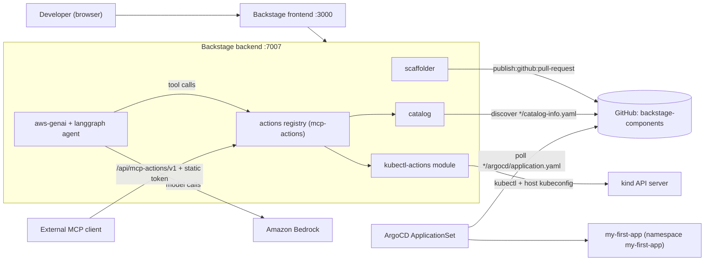
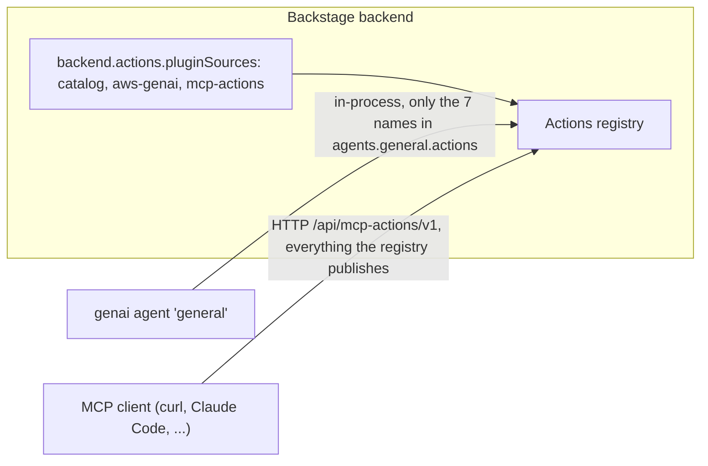
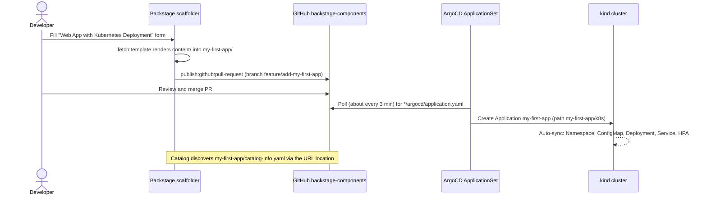
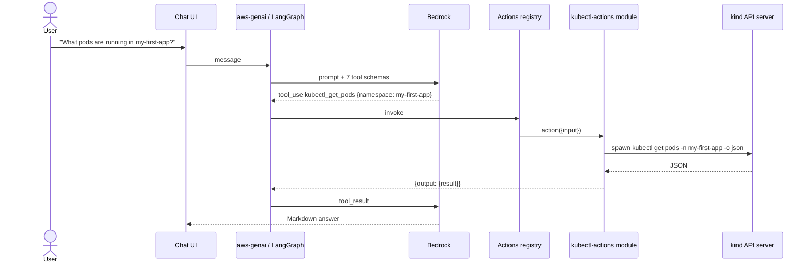

# Chapter 5 — Building an AI-Powered Backstage Platform: Deep Dive & Deployment Guide

> **Book:** [*Agentic AI for Platform Engineering*](https://www.oreilly.com/library/view/agentic-ai-for/9781806386659/) — Chapter 5, *Building an AI-Powered Backstage Platform*
> **Lab source:** [`chapter-05/`](../chapter-05/) · **Series index:** [guides/README.md](README.md) · **Previous:** [Chapter 4 guide](chapter-04-organizational-knowledge.md) · **Next:** [Chapter 7 guide](chapter-07-operational-agents.md)

> [!WARNING]
> Learning and experimentation only — see the [repository warning](../README.md). Not a production baseline.

| At a glance | |
|---|---|
| **Builds on** | [Lab 0 — cluster setup](00-cluster-setup.md): the kind cluster `agentic-platform` with Metrics Server and ArgoCD. Chapter 4 is not required. |
| **Feeds into** | [Chapter 7](chapter-07-operational-agents.md) and [Chapter 8](chapter-08-security-in-practice.md) reuse this Backstage app, the `backstage-components` repository, the ArgoCD ApplicationSet, the `argocd/github-creds` Secret, and `my-first-app`. |
| **Labs** | 4: Backstage + GitOps → AI chat assistant → catalog actions → Kubernetes actions (+ optional MCP client) |
| **Approx. time** | 3–4 hours on a first run. Lab 1 takes the longest because of the Backstage install. |
| **Cost / credentials** | A GitHub account and a fine-grained PAT (free). From Lab 2 on: Amazon Bedrock access (billed per token) or an OpenAI API key. |

> [!NOTE]
> The repository has no `chapter-06/` folder, so the next hands-on chapter after this one is Chapter 7. The two references to "Chapter 6" in [`00-cluster-setup`](../00-cluster-setup/README.md) and [`kind-config.yaml`](../00-cluster-setup/kind-config.yaml#L6) are left over from before the chapters were renumbered.

---

## 1. What you'll build

In this chapter you build an internal developer portal and then teach it to answer questions. In Lab 1 you create a Backstage app with a software template. The template opens a pull request against a GitOps repository, and an ArgoCD ApplicationSet deploys whatever gets merged. Labs 2–4 add an AI chat assistant to the same portal and widen what it can see step by step: first general knowledge only, then the software catalog, then live Kubernetes state. In the last step you expose the same actions to an external MCP client.



| Lab | What it adds | Key artifacts |
|---|---|---|
| [1 — Backstage + GitOps](../chapter-05/1-backstage-setup/README.md) | Backstage app, GitHub integration, ArgoCD auto-discovery, and a web-app template that opens a PR | [`template.yaml`](../chapter-05/1-backstage-setup/files/webapp-template/template.yaml), [`content/`](../chapter-05/1-backstage-setup/files/webapp-template/content/), [`argocd-applicationset.yaml`](../chapter-05/1-backstage-setup/files/argocd-applicationset.yaml), [`package-resolutions.json`](../chapter-05/1-backstage-setup/files/package-resolutions.json) |
| [2 — AI chat assistant](../chapter-05/2-add-chat-assistant/README.md) | The AWS GenAI plugin with a `general` agent backed by Bedrock, and no tools yet | `genai:` block in `app-config.yaml`, backend and frontend plugin wiring |
| [3 — Catalog actions](../chapter-05/3-add-catalog-actions/README.md) | Read access to the catalog and TechDocs through built-in actions | `backend.actions.pluginSources`, `genai.registerCoreActions`, the agent `actions:` list |
| [4 — Kubernetes actions](../chapter-05/4-add-kubernetes-actions/README.md) | Four read-only `kubectl` actions, plus the same registry served over MCP | [`kubectl-mcp-actions.ts`](../chapter-05/4-add-kubernetes-actions/files/kubectl-mcp-actions.ts), `backend.auth.externalAccess` |

---

## 2. Concepts deep dive

### 2.1 Backstage app anatomy

A Backstage app is a Yarn monorepo with two packages:

| Part | Path in your app | Role in this chapter |
|---|---|---|
| Frontend | `packages/app/` | React SPA served on `:3000`. You edit `src/App.tsx` (routes) and `src/components/Root/Root.tsx` (sidebar). |
| Backend | `packages/backend/` | Node service on `:7007` built with the new backend system: `createBackend()` followed by one `backend.add(import(...))` per plugin or module in `src/index.ts`. |
| Config | `app-config.yaml`, `app-config.local.yaml` | `yarn start` loads both, and the local file wins. Keep secrets in the local file, which is gitignored. |
| Examples | `examples/` | The scaffold's sample entities and templates. The lab adds `examples/webapp-template/` here. |

The template location target in `app-config.yaml` is `../../examples/webapp-template/template.yaml`. The two `../` are needed because the backend resolves `file` locations relative to its working directory, `packages/backend`.

**Why pin `@backstage/create-app@0.7.9`.** Later releases (`0.8.x+`) scaffold the new frontend system (`createApp({ features: [...] })`). Labs 2 and 4 edit the legacy frontend files `<FlatRoutes>` in `App.tsx` and `<SidebarItem>` in `Root.tsx`, so those edits only apply to the 0.7.9 layout ([Lab 1, Step 1](../chapter-05/1-backstage-setup/README.md#step-1-create-a-new-backstage-app)).

### 2.2 Pinning the `@backstage/*` galaxy with Yarn resolutions

Backstage ships about 200 packages that must agree with each other at runtime. In release `1.49.0+`, plugins declare a service ref, `alpha.core.metrics`, that no current factory provides. Their startup then fails with `Service or extension point dependencies of plugin 'X' are missing ... serviceRef{alpha.core.metrics}`. The lab avoids this by replacing the root `package.json` `resolutions` block with a snapshot ([`package-resolutions.json`](../chapter-05/1-backstage-setup/files/package-resolutions.json)) that contains:

- 193 `@backstage/*` packages pinned to release 1.48.0, for example `plugin-catalog-backend` `3.4.0` ([L82](../chapter-05/1-backstage-setup/files/package-resolutions.json#L82)), `plugin-scaffolder-backend` `3.1.3` ([L154](../chapter-05/1-backstage-setup/files/package-resolutions.json#L154)) and `plugin-mcp-actions-backend` `0.1.9` ([L136](../chapter-05/1-backstage-setup/files/package-resolutions.json#L136)).
- `@langchain/ollama` `0.2.4` and `@langchain/core` `0.3.66` ([L4-L5](../chapter-05/1-backstage-setup/files/package-resolutions.json#L4-L5)). The Lab 2 chat plugin needs these pins. Without them you get `ERR_PACKAGE_PATH_NOT_EXPORTED ./utils/uuid`.
- `@types/react` and `@types/react-dom` pinned to `^18`.

Resolutions, unlike `dependencies`, also force the version of **transitive** dependencies, which is exactly what a coherent snapshot needs. In production you would upgrade with `backstage-cli versions:bump` against a tested release rather than freezing a version forever.

### 2.3 Software templates as golden paths

[`template.yaml`](../chapter-05/1-backstage-setup/files/webapp-template/template.yaml) is a `scaffolder.backstage.io/v1beta3` Template with three parts:

1. **Parameters** ([L15-L72](../chapter-05/1-backstage-setup/files/webapp-template/template.yaml#L15-L72)). This is a three-page form built from JSON Schema. `name` is validated against `^[a-z0-9-]+$` so that it is a valid Kubernetes name, and `owner` uses the `OwnerPicker` UI field filtered to `Group`/`User`.
2. **Steps** ([L74-L100](../chapter-05/1-backstage-setup/files/webapp-template/template.yaml#L74-L100)). `fetch:template` renders [`content/`](../chapter-05/1-backstage-setup/files/webapp-template/content/) into `./<name>/`, replacing `${{ values.* }}`. `publish:github:pull-request` then pushes the result to branch `feature/add-<name>` and opens a PR. Nothing reaches the cluster directly.
3. **Output** ([L102-L105](../chapter-05/1-backstage-setup/files/webapp-template/template.yaml#L102-L105)): a link to the PR.

The rendered folder is a complete unit of delivery. It contains a `catalog-info.yaml` that Backstage discovers, the `k8s/` manifests ArgoCD syncs, and an `argocd/application.yaml` marker the ApplicationSet watches for. The template renders in a sandbox built on `isolated-vm`, which is why every `yarn start` in this chapter is prefixed with `NODE_OPTIONS=--no-node-snapshot` and why Node 22.x is required.

### 2.4 PR-based GitOps with an ApplicationSet Git generator

```yaml
# chapter-05/1-backstage-setup/files/argocd-applicationset.yaml (L9-L17)
  generators:
  - git:
      repoURL: https://github.com/YOUR_USERNAME/backstage-components
      revision: HEAD
      files:
      - path: "*/argocd/application.yaml"
  template:
    metadata:
      name: '{{path[0]}}'
```

The ApplicationSet controller polls the repository (every 3 minutes by default). For every `*/argocd/application.yaml` it finds, it generates one Application whose name, source path (`{{path[0]}}/k8s`) and destination namespace all come from the **first path segment**, which is the app folder name ([L15-L29](../chapter-05/1-backstage-setup/files/argocd-applicationset.yaml#L15-L29)). Three consequences are worth knowing:

- **The marker file is never applied.** Its presence is the discovery signal, and the ApplicationSet's own template defines the Application. Do not `kubectl apply` the rendered [`argocd/application.yaml`](../chapter-05/1-backstage-setup/files/webapp-template/content/argocd/application.yaml). It would create a second, unmanaged Application with the same name.
- **Keep the template's `namespace` equal to the app `name`.** `CreateNamespace=true` creates the namespace named after the folder ([L34-L35](../chapter-05/1-backstage-setup/files/argocd-applicationset.yaml#L34-L35)), but the rendered manifests carry an explicit `metadata.namespace: ${{ values.namespace }}`. If the two differ, the sync targets a namespace that nobody created. That is why Lab 1 has you change the namespace from `default` to `my-first-app`.
- **Sync is fully automated.** With `prune: true`, `selfHeal: true` and retry with backoff ([L30-L41](../chapter-05/1-backstage-setup/files/argocd-applicationset.yaml#L30-L41)), Git is the only lever you have. Any manual change in the cluster is reverted.

The manifest uses ArgoCD's legacy template syntax (`{{path[0]}}`). With `goTemplate: true` the same value is written `{{index .path.segments 0}}`.

> [!TIP]
> **Production note: HPA vs. self-heal.** The rendered Deployment sets `spec.replicas` ([deployment.yaml L10](../chapter-05/1-backstage-setup/files/webapp-template/content/k8s/deployment.yaml#L10)) and is also scaled by an HPA ([hpa.yaml](../chapter-05/1-backstage-setup/files/webapp-template/content/k8s/hpa.yaml)). If the HPA ever scales beyond the Git value, ArgoCD sees drift and self-heal can fight the autoscaler. Production templates usually drop `replicas` when an HPA is present, or add an ArgoCD `ignoreDifferences` rule for `/spec/replicas`. In the lab this never triggers, because idle nginx stays below the 70% CPU target.

### 2.5 One GitHub token, several consumers

The fine-grained PAT from [Lab 1, Part 2](../chapter-05/1-backstage-setup/README.md#step-2-create-a-github-personal-access-token) is scoped to the single `backstage-components` repository and is used in three places:

| Consumer | Where configured | Permissions it actually needs |
|---|---|---|
| Backstage scaffolder (`publish:github:pull-request`) | `integrations.github[].token` in `app-config.local.yaml` | Contents R/W (branch + commit), Pull requests R/W |
| Backstage catalog (URL discovery of `*/catalog-info.yaml`) | same integration | Contents R |
| ArgoCD repository credential (private repos) | Secret `argocd/github-creds`, label `argocd.argoproj.io/secret-type=repository` | Contents R |

The lab also grants Actions R, Commit statuses R and Issues R/W. Metadata R is mandatory and selected automatically. Chapter 7 reads the **same** Secret again to give its GitOps agent PR access ([Chapter 7, Lab 0](../chapter-07/0-prereqs/README.md#create-the-lab-credentials)). In production you would split this into a read-only credential for ArgoCD and a GitHub App, or a separate least-privilege token, for anything that writes.

### 2.6 The AWS GenAI plugin

The [GenAI plugin](https://github.com/awslabs/backstage-plugins-for-aws/tree/main/plugins/genai) is made of three packages ([Lab 2, Steps 1–3](../chapter-05/2-add-chat-assistant/README.md#step-1-install-backend-dependencies)):

| Package | Workspace | Role |
|---|---|---|
| `@aws/genai-plugin-for-backstage` | `app` | `AgentChatPage` UI, mounted at `/assistant/:agentName` |
| `@aws/genai-plugin-for-backstage-backend` | `backend` | The `aws-genai` backend plugin: chat API, agent registry, session history |
| `@aws/genai-plugin-langgraph-agent-for-backstage` | `backend` | The LangGraph agent implementation: model loop plus tool calling |

The URL segment `:agentName` selects `genai.agents.<name>` in `app-config.yaml`. The sidebar link `assistant/general` therefore resolves to the `general` agent. Each agent defines:

- `prompt`: the system prompt. `{username}` is replaced with the signed-in user, so the guest user in this lab.
- `langgraph.messagesMaxTokens`: how much conversation history is kept before older messages are pruned.
- `langgraph.bedrock.modelId: 'global.anthropic.claude-sonnet-4-5-20250929-v1:0'` with `region: us-west-2`. The `global.` prefix is a Bedrock **global cross-Region inference profile**, which routes requests across AWS Regions. That is why the configuration names a profile rather than a base model ID.
- `actions`: an **allowlist** of tool names. This list is empty in Lab 2.

The plugin depends on the actions registry service from the start. `@backstage/plugin-mcp-actions-backend` is therefore installed in Lab 2 and registered **before** the GenAI imports, even though MCP is only discussed in Lab 4.

### 2.7 The actions registry: one registration, two doors

Backstage plugins register **actions**: typed functions with a name, a description, and zod input and output schemas. The registry is then reachable two ways:



- `backend.actions.pluginSources` decides which plugins' actions the actions service will see: `catalog`, `aws-genai`, and from Lab 4 `mcp-actions`.
- `genai.registerCoreActions: true` makes the GenAI plugin register its own catalog and TechDocs helpers (`get-catalog-entity`, `search-catalog`, `search-techdocs`).
- The agent can call only the actions named in its `actions:` list. The MCP endpoint publishes **everything** in the registry. On this setup that is 13 tools, including the catalog-mutating `register-entity` and `unregister-entity` ([Lab 4, "What this shows"](../chapter-05/4-add-kubernetes-actions/README.md#what-this-shows-and-one-warning)). The static MCP token therefore has a wider reach than the chat assistant.

> [!NOTE]
> The current Backstage docs describe newer behavior: MCP tool names prefixed with the plugin ID (for example `my-plugin.greet-user`), `backend.actions.filter`, and per-server `mcpActions.servers`. The lab pins `plugin-mcp-actions-backend` `0.1.9`, where the tools are called by their bare names (`kubectl_get_pods`). Always use the names your server returns from `tools/list`.

### 2.8 Custom kubectl actions and how they reach the cluster

[`kubectl-mcp-actions.ts`](../chapter-05/4-add-kubernetes-actions/files/kubectl-mcp-actions.ts) is a backend **module** for the `mcp-actions` plugin ([L35-L37](../chapter-05/4-add-kubernetes-actions/files/kubectl-mcp-actions.ts#L35-L37)). It injects `actionsRegistryServiceRef` and registers four actions:

```ts
// kubectl-mcp-actions.ts L45-L62 (abridged)
actionsRegistry.register({
  name: 'kubectl_get_pods',
  schema: {
    input:  zod => zod.object({ namespace: zod.string().default('default') }),
    output: zod => zod.object({ result: zod.string() }),
  },
  action: async ({ input }) => {
    const result = await execKubectl(['get', 'pods', '-n', input.namespace, '-o', 'json']);
    return { output: { result } };
  },
});
```

- **Transport.** `execKubectl` ([L7-L33](../chapter-05/4-add-kubernetes-actions/files/kubectl-mcp-actions.ts#L7-L33)) calls `spawn('kubectl', args)` with an argument array and no shell, so the model cannot inject shell syntax.
- **Identity.** The kubectl process runs as **you**: it uses whatever kubeconfig and current context the Backstage backend inherited. On kind that is cluster-admin. The actions are read-only because of the verbs the code uses (`get`, `describe`), not because of RBAC.
- **Output contract.** The action returns `{ output: { result } }` because the registry validates return values against the declared output schema ([L54-L57](../chapter-05/4-add-kubernetes-actions/files/kubectl-mcp-actions.ts#L54-L57)).
- **Token cost.** `-o json` returns full objects, so a large namespace sends a lot of JSON into the model context.

In production you would run the backend with a dedicated ServiceAccount and read-only RBAC, validate inputs as Kubernetes names, and return trimmed fields. You might also replace the module entirely with the official Kubernetes MCP server in read-only mode, which is what [Chapter 7, Lab 2](../chapter-07/2-cluster-diagnostics/README.md) does.

---

## 3. Prerequisites

**Tools**

- [ ] Docker, kind and kubectl, plus the cluster from [`00-cluster-setup`](00-cluster-setup.md) with Metrics Server and **ArgoCD `v3.0.21`** (`./setup-cluster.sh` without `SKIP_ARGOCD`).
- [ ] **Node.js 22.x.** `isolated-vm` requires it. On Apple Silicon, use a native arm64 Node build rather than an x64 one under Rosetta, because `isolated-vm` is a native module.
- [ ] **Yarn 4.x** through Corepack (`corepack enable`).
- [ ] A C/C++ build toolchain for native modules (Backstage prerequisite): `xcode-select --install` on macOS, or `make` and `build-essential` on Debian/Ubuntu.
- [ ] Git, curl, jq. Optional: AWS CLI v2 for the Bedrock smoke test, and Claude Code or another MCP client for Lab 4 Step 8.

**Accounts and credentials**

- [ ] A GitHub account, an empty-but-initialized repo `backstage-components` (it **must** contain a README commit), and a fine-grained PAT ([Lab 1, Part 2](../chapter-05/1-backstage-setup/README.md#part-2-configure-github-integration)).
- [ ] From Lab 2: AWS credentials that can invoke `global.anthropic.claude-sonnet-4-5-20250929-v1:0` in `us-west-2`, or an OpenAI API key (see the [plugin docs](https://github.com/awslabs/backstage-plugins-for-aws/tree/main/plugins/genai)).

```bash
node --version        # v22.x
corepack enable && yarn --version   # 4.x inside the Backstage app
kubectl config current-context      # kind-agentic-platform
kubectl -n argocd get deployment argocd-server
```

**Environment variables**

| Name | Default | Purpose | Used in |
|---|---|---|---|
| `NODE_OPTIONS` | — (set per command to `--no-node-snapshot`) | Lets the scaffolder's `isolated-vm` sandbox run on Node 20+ | every `yarn start` |
| `GITHUB_TOKEN` | — | Referenced by `integrations.github[].token` in the generated `app-config.yaml`. The lab puts the PAT in `app-config.local.yaml` instead. | Lab 1 |
| `AWS_ACCESS_KEY_ID` / `AWS_SECRET_ACCESS_KEY` / `AWS_REGION` | `AWS_REGION=us-west-2` | Bedrock credentials. Add `AWS_SESSION_TOKEN` if your credentials are temporary. | Lab 2+ |
| `OPENAI_API_KEY` | — | Alternative provider (`genai.agents.*.langgraph.openai.apiKey`) | Lab 2 (alt.) |
| `MCP_CLIENT_TOKEN` | — | Static external-access token for the MCP endpoint | Lab 4 Step 8 |
| `GITHUB_USERNAME`, `GITHUB_TOKEN` | — | Optional inputs to [`verify.sh`](../00-cluster-setup/verify.sh#L10) to test the PAT | verification |
| `BOOK_REPO`, `BACKSTAGE_APP`, `COMPONENTS_REPO` | — | **Guide convenience paths** (the same names Chapter 7 uses): your clone of this repo, your Backstage app, and your clone of `backstage-components` | copy steps |

```bash
export BOOK_REPO=/absolute/path/to/Agentic-AI-for-Platform-Engineering
export BACKSTAGE_APP=/absolute/path/to/my-backstage-app      # created in Lab 1
```

> [!NOTE]
> The lab READMEs copy files from `../ai-driven-platform-engineering/chapter-05/...` ([Lab 1, Step 2](../chapter-05/1-backstage-setup/README.md#step-2-pin-backstage-package-versions); [Lab 4, Step 2](../chapter-05/4-add-kubernetes-actions/README.md#step-2-add-the-kubectl-actions-module)). That folder name comes from an older checkout. This guide uses `$BOOK_REPO` instead, so the paths work wherever you cloned the repository.

---

## Lab 1 — Setting up Backstage with GitOps

### Goal

Create a Backstage app that can scaffold a web app as a **pull request**, and have ArgoCD deploy the app automatically once that PR is merged: template → PR → human merge → ArgoCD sync.

### How it works



Rendered resources ([`content/k8s/`](../chapter-05/1-backstage-setup/files/webapp-template/content/k8s/)): an nginx Deployment (`public.ecr.aws/nginx/nginx:alpine`, multi-arch) serving a ConfigMap-backed `index.html`, a ClusterIP Service on port 80, and an HPA that targets 70% CPU. The Component's [`catalog-info.yaml`](../chapter-05/1-backstage-setup/files/webapp-template/content/catalog-info.yaml#L6-L9) carries `backstage.io/kubernetes-id`, `backstage.io/kubernetes-namespace` and `github.com/project-slug` annotations. Later labs and chapters use them to map the catalog entity to the cluster and the repository.

### Deploy

1. **Cluster** (skip if already done):

   ```bash
   cd "$BOOK_REPO/00-cluster-setup"
   ./setup-cluster.sh   # kind cluster 'agentic-platform' + Metrics Server + ArgoCD
   ./verify.sh          # sanity-check
   ```

2. **Create the Backstage app** (pinned to 0.7.9; enter the app name when prompted):

   ```bash
   cd /path/where/you/keep/projects
   npx @backstage/create-app@0.7.9
   # When prompted, enter your app name (e.g., "my-backstage-app")
   cd my-backstage-app
   export BACKSTAGE_APP="$PWD"
   ```

3. **Pin package versions.** Replace the **entire** `resolutions` block in the root `package.json` with the contents of [`package-resolutions.json`](../chapter-05/1-backstage-setup/files/package-resolutions.json). You can edit the file by hand, or run this one-liner, which does the same replacement:

   ```bash
   node -e '
   const fs = require("fs");
   const pkg = JSON.parse(fs.readFileSync("package.json", "utf8"));
   pkg.resolutions = JSON.parse(fs.readFileSync(process.env.BOOK_REPO + "/chapter-05/1-backstage-setup/files/package-resolutions.json", "utf8"));
   fs.writeFileSync("package.json", JSON.stringify(pkg, null, 2) + "\n");'
   yarn install
   ```

4. **Smoke-test Backstage:**

   ```bash
   NODE_OPTIONS=--no-node-snapshot yarn start
   # open http://localhost:3000 — the welcome page should load; Ctrl+C to stop
   ```

5. **Create the GitHub repository and PAT** ([Lab 1, Part 2](../chapter-05/1-backstage-setup/README.md#part-2-configure-github-integration)):
   - Create `backstage-components` and **tick "Add a README file"**. Backstage cannot open a PR against an empty repository.
   - Create a fine-grained PAT with access to **only** that repository and these permissions: Actions R, Commit statuses R, **Contents R/W**, Issues R/W, Metadata R, **Pull requests R/W**.

6. **Give Backstage the token** in `app-config.local.yaml` (gitignored):

   ```yaml
   integrations:
     github:
       - host: github.com
         token: github_pat_your_token_here
   ```

7. **Wire ArgoCD to the repository.** Replace `YOUR_USERNAME` (two occurrences, [L11](../chapter-05/1-backstage-setup/files/argocd-applicationset.yaml#L11) and [L24](../chapter-05/1-backstage-setup/files/argocd-applicationset.yaml#L24)) in your copy of the ApplicationSet, then apply it:

   ```bash
   cd "$BOOK_REPO/chapter-05/1-backstage-setup"
   # edit files/argocd-applicationset.yaml: YOUR_USERNAME -> your GitHub username
   kubectl apply -f files/argocd-applicationset.yaml
   ```

8. **Create the repository credential.** The lab requires it for private repositories. **Create it even if your repository is public**, because Chapter 7 reads the `url` and `password` keys from this Secret:

   ```bash
   # Create a repository secret with your GitHub credentials (replace YOUR_USERNAME and token)
   kubectl create secret generic github-creds -n argocd \
     --from-literal=type=git \
     --from-literal=url=https://github.com/YOUR_USERNAME/backstage-components \
     --from-literal=username=YOUR_USERNAME \
     --from-literal=password=github_pat_your_token_here

   # Label it so ArgoCD recognizes it as a repository secret
   kubectl label secret github-creds -n argocd argocd.argoproj.io/secret-type=repository
   ```

9. **Add the web-app template** to your Backstage app:

   ```bash
   cp -r "$BOOK_REPO/chapter-05/1-backstage-setup/files/webapp-template/" "$BACKSTAGE_APP/examples/webapp-template/"
   ```

10. **Register the template and auto-discovery** under `catalog.locations` in `app-config.yaml`, replacing `YOUR_USERNAME`:

    ```yaml
    catalog:
      locations:
        # ... existing locations ...

        # Web App Kubernetes template
        - type: file
          target: ../../examples/webapp-template/template.yaml
          rules:
            - allow: [Template]

        # Auto-discover components from GitHub (replace YOUR_USERNAME)
        - type: url
          target: https://github.com/YOUR_USERNAME/backstage-components/blob/main/*/catalog-info.yaml
          rules:
            - allow: [Component]
    ```

11. **Run the full flow:**

    ```bash
    cd "$BACKSTAGE_APP"
    NODE_OPTIONS=--no-node-snapshot yarn start
    ```

    In `http://localhost:3000`, go to **Create...** → **Web App with Kubernetes Deployment** and fill in Name `my-first-app`, Description `My first Backstage-deployed app`, Owner `user:default/guest`, **Namespace `my-first-app`** (change it from `default`), GitHub Owner = your username, and Repository Name `backstage-components`. Then click **Create**.

12. **Merge the PR** that Backstage opened on GitHub, then wait up to 3 minutes for the ApplicationSet to poll the repository.

### Verify

```bash
# ArgoCD side
kubectl -n argocd get applicationset backstage-app-discovery
kubectl -n argocd get applications            # my-first-app -> Synced / Healthy
kubectl -n my-first-app get deploy,svc,hpa,configmap
kubectl -n my-first-app get pods -w           # 2 pods Running

# Reach the app (use 8081 if the ArgoCD UI port-forward already holds 8080)
kubectl port-forward svc/my-first-app 8081:80 -n my-first-app
# open http://localhost:8081

# ArgoCD UI (optional)
kubectl -n argocd get secret argocd-initial-admin-secret -o jsonpath="{.data.password}" | base64 -d; echo
kubectl port-forward svc/argocd-server -n argocd 8080:443   # https://localhost:8080, user admin
```

Success looks like this: the scaffolder task ends with a **Pull Request** link, the Application shows `Synced`/`Healthy`, the HPA shows a CPU percentage (not `<unknown>`) after about a minute, and `my-first-app` appears in the Backstage **Catalog** after the next catalog refresh.

> [!NOTE]
> Lab 1 Part 5 Step 5 port-forwards the app to local port `8080`, which is also the port the ArgoCD UI forward uses in Part 3. If both are running, give one of them a different local port, as shown above.

### Explore further

1. **Watch self-heal.** Delete the Service with `kubectl -n my-first-app delete svc my-first-app`, then run `kubectl -n my-first-app get svc -w`. ArgoCD recreates it, because Git is the source of truth.
2. **Watch the generator fan out.** Scaffold a second app, `my-second-app` with namespace `my-second-app`, and merge the PR. `kubectl -n argocd get applications` now lists two Applications that came from one ApplicationSet.
3. **Inspect the generator.** Run `kubectl -n argocd get applicationset backstage-app-discovery -o yaml` and read `status.conditions` and `status.resources`. To make the lab faster, add `requeueAfterSeconds: 30` under the `git:` generator and re-apply.
4. **Change the golden path.** Add a template parameter, for example a `cpuLimit` used in [`deployment.yaml`](../chapter-05/1-backstage-setup/files/webapp-template/content/k8s/deployment.yaml#L29-L31), then dry-run it in the scaffolder's Template Editor before opening a real PR.

### Troubleshooting

| Symptom | Likely cause | Fix |
|---|---|---|
| `yarn install` fails compiling `isolated-vm` | Wrong Node major version or no native toolchain | Use Node 22.x (arm64 build on Apple Silicon) and install Xcode CLT or `build-essential` |
| Backend exits with `serviceRef{alpha.core.metrics}` missing | `resolutions` not applied, so 1.49+ packages were installed | Re-apply [`package-resolutions.json`](../chapter-05/1-backstage-setup/files/package-resolutions.json) and run `yarn install`; check with `yarn why @backstage/plugin-catalog-backend` (expect `3.4.0`) |
| `App.tsx` has no `<FlatRoutes>` | The app was scaffolded with create-app 0.8.x+ | Recreate it with `npx @backstage/create-app@0.7.9` |
| Template missing from **Create...** | Wrong location path or rules | Use `target: ../../examples/webapp-template/template.yaml` with `allow: [Template]`, then restart |
| Scaffolder fails at "Create Pull Request" | Empty repo, PAT not scoped to the repo, or missing Contents/PR write | Add a README commit and fix the PAT repository access and permissions |
| No Application after 3+ minutes | `YOUR_USERNAME` not replaced, private repo without `github-creds`, or the PR not merged to `main` | `kubectl -n argocd describe applicationset backstage-app-discovery`; `kubectl -n argocd logs deploy/argocd-applicationset-controller` |
| Sync error: namespace not found | Template namespace differs from the app name | Keep namespace equal to the name (see [§2.4](#24-pr-based-gitops-with-an-applicationset-git-generator)) |
| HPA `TARGETS <unknown>` | Metrics Server not ready | `kubectl -n kube-system get deploy metrics-server`; re-run `setup-cluster.sh` |
| `bind: address already in use` on 8080 | The ArgoCD UI port-forward is still running | Use another local port |

---

## Lab 2 — Adding the AI chat assistant

### Goal

Add a **Chat Assistant** to the sidebar, backed by Amazon Bedrock (or OpenAI), that answers general platform questions. On purpose, it has no tools at this stage.

### How it works

`/assistant/general` → `AgentChatPage` → `aws-genai` backend → LangGraph agent `general` → Bedrock Converse with the system prompt from `app-config.yaml`. The agent's `actions` list is empty, so the model can only answer from its training data. Ask it "What services do we have?" and it cannot know. That gap is what Lab 3 closes.

### Deploy

All commands run from `$BACKSTAGE_APP`.

1. **Backend packages** (`mcp-actions-backend` is required now; see [§2.6](#26-the-aws-genai-plugin)):

   ```bash
   yarn workspace backend add \
     @aws/genai-plugin-for-backstage-backend \
     @aws/genai-plugin-langgraph-agent-for-backstage \
     @backstage/plugin-mcp-actions-backend
   ```

2. **Register them** in `packages/backend/src/index.ts` before `backend.start()`, keeping **this order**:

   ```ts
   // MCP actions registry (provides core.actionsRegistry; required by aws-genai)
   backend.add(import('@backstage/plugin-mcp-actions-backend'));

   // GenAI plugin
   backend.add(import('@aws/genai-plugin-for-backstage-backend'));
   backend.add(import('@aws/genai-plugin-langgraph-agent-for-backstage'));
   ```

3. **Frontend package and route:**

   ```bash
   yarn workspace app add @aws/genai-plugin-for-backstage
   ```

   In `packages/app/src/App.tsx`, add `import { AgentChatPage } from '@aws/genai-plugin-for-backstage';` and put this route inside `<FlatRoutes>`:

   ```tsx
   <Route path="/assistant/:agentName" element={<AgentChatPage />} />
   ```

4. **Sidebar entry.** In `packages/app/src/components/Root/Root.tsx`, add `import { ChatIcon } from '@backstage/core-components';` and put this item inside the `<SidebarGroup>`:

   ```tsx
   <SidebarItem icon={ChatIcon} to="assistant/general" text="Chat Assistant"/>
   ```

5. **Agent config** in `app-config.yaml`:

   ```yaml
   genai:
     agents:
       general: # This matches the URL in the frontend
         description: General chat assistant
         prompt: >
           You are an expert in platform engineering and answer questions in a succinct and easy to understand manner.

           Answers should always be well-structured and use well-formed Markdown.

           The current user is {username} and you can provide that information if asked.
         langgraph:
           messagesMaxTokens: 150000 # Set based on context of chosen model, prune message history based on number of tokens
           # Use appropriate snippet for your model provider
           bedrock:
             modelId: 'global.anthropic.claude-sonnet-4-5-20250929-v1:0'
             region: us-west-2
           # openai:
           #   apiKey: ${OPENAI_API_KEY}
   ```

6. **Credentials and start**, in the same shell:

   ```bash
   export AWS_ACCESS_KEY_ID=your-access-key
   export AWS_SECRET_ACCESS_KEY=your-secret-key
   export AWS_REGION=us-west-2
   NODE_OPTIONS=--no-node-snapshot yarn start
   ```

### Verify

Before starting Backstage, you can optionally check from the shell that these credentials can call the model. The second command makes one small, billed model call:

```bash
aws sts get-caller-identity
aws bedrock-runtime converse --region us-west-2 \
  --model-id global.anthropic.claude-sonnet-4-5-20250929-v1:0 \
  --messages '[{"role":"user","content":[{"text":"Reply with OK"}]}]' \
  --query 'output.message.content[0].text'
```

In the UI, open `http://localhost:3000/assistant/general` and ask "What is Backstage?". You should get a Markdown answer. Then ask "What components do we have in the catalog?" The assistant cannot see your catalog yet, so it should say it doesn't know or answer generically.

### Explore further

1. **Prompt variables.** Ask "Who am I?" The answer comes from the `{username}` substitution, not from any tool.
2. **Multiple agents.** Add a second agent under `genai.agents` (for example `reviewer`, with a stricter prompt) and open `/assistant/reviewer`. The route parameter selects the agent without any code change.
3. **History pruning.** Temporarily set `messagesMaxTokens` very low (for example `2000`), have a long conversation, and watch earlier context drop out.

### Troubleshooting

| Symptom | Likely cause | Fix |
|---|---|---|
| `AccessDeniedException` or Bedrock errors | Bad or expired credentials, or no model access in the account | Re-export the credentials (add `AWS_SESSION_TOKEN` for temporary ones) and check model access in the Bedrock console |
| "on-demand throughput isn't supported" | A base model ID was used instead of an inference profile | Keep the `global.` profile ID from the lab config |
| `serviceRef{alpha.core.actions}` / `actionsRegistry` missing for `aws-genai` | `mcp-actions-backend` missing or registered after the GenAI plugin | Install it and move its `backend.add` above the GenAI lines |
| `serviceRef{alpha.core.metrics}` | `resolutions` not pinned | Re-apply the resolutions and run `yarn install` |
| `ERR_PACKAGE_PATH_NOT_EXPORTED ./utils/uuid` | `@langchain/*` pins missing | Same fix: resolutions, then `yarn install` |
| No sidebar entry or a blank page | Route or import missing in `App.tsx`/`Root.tsx` | Check the browser console and both edits |

> [!NOTE]
> Lab 2's prerequisites link to `github.com/awslabs/genai-for-backstage`, while the [chapter README](../chapter-05/README.md) links to [`awslabs/backstage-plugins-for-aws/plugins/genai`](https://github.com/awslabs/backstage-plugins-for-aws/tree/main/plugins/genai). Use the second link for the plugin's documentation, including the OpenAI options. The lab text also names the missing service ref inconsistently, once as `alpha.core.actionsRegistry` and once as `alpha.core.actions`. Both errors have the same cause and the same fix.

---

## Lab 3 — Adding Backstage catalog actions

### Goal

Let the assistant **read** the software catalog and TechDocs, using built-in actions and configuration only.

### How it works

`backend.actions.pluginSources` makes the `catalog` and `aws-genai` actions visible to the actions service. `genai.registerCoreActions: true` registers the catalog and TechDocs helpers, and the agent's `actions:` allowlist hands three of them to the model as tools. When you ask "Tell me about my-first-app", the model emits a `get-catalog-entity` or `search-catalog` tool call. The backend runs it and returns the entity YAML, including the annotations from Lab 1, and the model answers from that data.

### Deploy

1. Add to `app-config.yaml`:

   ```yaml
   backend:
     # ... existing backend config ...
     actions:
       pluginSources:
         - 'catalog'      # Enables catalog actions
         - 'aws-genai'    # Enables genai core actions
   ```

2. Update the `genai` block:

   ```yaml
   genai:
     registerCoreActions: true  # Important: registers built-in actions
     agents:
       general:
         # description / prompt / langgraph unchanged from Lab 2
         actions:
           - get-catalog-entity  # Fetch specific entity by kind/namespace/name
           - search-catalog      # Search across all catalog entities
           - search-techdocs     # Search technical documentation
   ```

3. Restart Backstage with `NODE_OPTIONS=--no-node-snapshot yarn start`.

### Verify

At `http://localhost:3000/assistant/general`, ask:

- "What components do we have in the catalog?" The answer should list `my-first-app` and the sample entities from the scaffold.
- "Tell me about the my-first-app component." The answer should include its owner, its `website` type, and the Kubernetes namespace annotation.

### Explore further

1. **Multi-hop questions.** Ask "Who owns my-first-app and which namespace is it deployed to?" and check the backend logs for the tool calls behind the answer.
2. **The allowlist is the boundary.** Remove `search-catalog` from `actions`, restart, and ask the same listing question. The assistant now has to fall back to `get-catalog-entity` or admit that it cannot list.
3. **TechDocs.** `my-first-app` has no TechDocs, so `search-techdocs` mostly returns the scaffold's sample docs. Add a `backstage.io/techdocs-ref` annotation and docs to a component to see grounded documentation answers.

### Troubleshooting

| Symptom | Likely cause | Fix |
|---|---|---|
| "Action not found" | `registerCoreActions` missing, a typo in an action name, or `pluginSources` incomplete | Names are case-sensitive; `pluginSources` must include `catalog` and `aws-genai` |
| The assistant does not know `my-first-app` | Catalog has not discovered it, or the PR is not merged | Check **Catalog** in the UI; confirm the `url` location and the PAT; wait for the refresh |
| Empty TechDocs results | Nothing indexed | Expected for the lab app; see Explore 3 |

---

## Lab 4 — Adding Kubernetes MCP actions

### Goal

Give the assistant four read-only Kubernetes tools. Then, optionally, call the same registered actions from an external MCP client, the "second door".

### How it works



See [§2.8](#28-custom-kubectl-actions-and-how-they-reach-the-cluster) for the identity and security implications. The module runs `kubectl` with **your** current kube-context.

### Deploy

1. **Install zod** (`mcp-actions-backend` is already installed):

   ```bash
   cd "$BACKSTAGE_APP"
   yarn workspace backend add zod
   ```

2. **Copy the module:**

   ```bash
   mkdir -p packages/backend/src/modules
   cp "$BOOK_REPO/chapter-05/4-add-kubernetes-actions/files/kubectl-mcp-actions.ts" packages/backend/src/modules/
   ```

3. **Register it** in `packages/backend/src/index.ts`, after the Lab 2 lines and before `backend.start()`:

   ```ts
   // Kubectl actions module (chapter-05 lab 4)
   backend.add(import('./modules/kubectl-mcp-actions'));
   ```

4. **Add `mcp-actions` to `pluginSources`:**

   ```yaml
   backend:
     actions:
       pluginSources:
         - 'catalog'      # Enables catalog actions
         - 'aws-genai'    # Enables genai core actions
         - 'mcp-actions'  # Enables MCP actions (kubectl)
   ```

5. **Extend the agent's `actions`** list with the four new tools:

   ```yaml
         actions:
           # Catalog actions (from Lab 3)
           - get-catalog-entity
           - search-catalog
           - search-techdocs
           # Kubernetes actions
           - kubectl_get_pods
           - kubectl_get_deployments
           - kubectl_get_services
           - kubectl_describe_pod
   ```

6. **Check the kube-context** of the shell that will run Backstage, then start it:

   ```bash
   kubectl config current-context   # kind-agentic-platform
   kubectl get ns
   NODE_OPTIONS=--no-node-snapshot yarn start
   ```

### Verify

Ask the assistant:

- "What pods are running in the my-first-app namespace?" It should list two `my-first-app-*` pods in `Running`.
- "Show me all deployments in my-first-app."
- "Are there any pods in CrashLoopBackOff state?"

### Step 8 (optional) — The MCP endpoint

1. Add a static external-access token to `app-config.local.yaml`:

   ```yaml
   backend:
     auth:
       externalAccess:
         - type: static
           options:
             token: ${MCP_CLIENT_TOKEN}
             subject: mcp-client
   ```

2. Generate the token and start the backend:

   ```bash
   export MCP_CLIENT_TOKEN=$(node -e "console.log(require('crypto').randomBytes(24).toString('base64'))")
   yarn workspace backend start
   ```

   > [!IMPORTANT]
   > From now on, `app-config.local.yaml` references `${MCP_CLIENT_TOKEN}`. Export the variable in **every** shell that runs `yarn start` or `yarn workspace backend start`, or the backend may refuse to load its config.

3. Run the three MCP calls: `initialize`, `tools/list` and `tools/call`. Responses arrive as server-sent events, so strip the `data: ` prefix before passing them to `jq`:

   ```bash
   MCP=http://localhost:7007/api/mcp-actions/v1
   H=(-H "Authorization: Bearer $MCP_CLIENT_TOKEN" -H 'Content-Type: application/json' -H 'Accept: application/json, text/event-stream')

   curl -s -X POST $MCP "${H[@]}" -d '{"jsonrpc":"2.0","id":1,"method":"initialize","params":{
         "protocolVersion":"2025-06-18","capabilities":{},
         "clientInfo":{"name":"my-client","version":"1.0"}}}'

   curl -s -X POST $MCP "${H[@]}" -d '{"jsonrpc":"2.0","id":2,"method":"tools/list"}' \
     | sed 's/^data: //' | jq -r '.result.tools[].name'

   curl -s -X POST $MCP "${H[@]}" -d '{"jsonrpc":"2.0","id":3,"method":"tools/call","params":{
         "name":"kubectl_get_pods","arguments":{"namespace":"argocd"}}}'
   ```

   `initialize` should report `"serverInfo":{"name":"backstage","version":"0.1.9"}`, which matches the pinned plugin version. `tools/list` returns more tools than the agent's seven (13 on the lab setup), including `register-entity` and `unregister-entity`.

4. Connect a real MCP client. With Claude Code, either commit a project `.mcp.json`:

   ```json
   {
     "mcpServers": {
       "backstage": {
         "type": "http",
         "url": "http://localhost:7007/api/mcp-actions/v1",
         "headers": {
           "Authorization": "Bearer ${MCP_CLIENT_TOKEN}"
         }
       }
     }
   }
   ```

   or register the server just for yourself:

   ```bash
   claude mcp add --transport http backstage http://localhost:7007/api/mcp-actions/v1 \
     --header "Authorization: Bearer $MCP_CLIENT_TOKEN"
   claude mcp list   # backstage: http://localhost:7007/api/mcp-actions/v1 (HTTP) - Connected
   ```

   If your Claude Code version rejects that order of options, see the [Claude Code MCP docs](https://code.claude.com/docs/en/mcp) for the current syntax.

### Explore further

1. **Break and diagnose.** Run `kubectl -n my-first-app set image deploy/my-first-app nginx=public.ecr.aws/nginx/nginx:does-not-exist` and quickly ask "Why are pods failing in my-first-app?" The assistant should find `ImagePullBackOff` through `kubectl_describe_pod`. ArgoCD self-heal then restores the Git version, which previews the Chapter 7 workflow, where the repair goes through a PR instead.
2. **Harden the inputs.** In your copy of the module, constrain `namespace` and `pod_name` with a zod regex such as `^[a-z0-9]([-a-z0-9]*[a-z0-9])?$`. Then try a prompt that asks for `--all-namespaces` as a "namespace".
3. **Count the surfaces.** Compare the agent's seven allowlisted actions with the `tools/list` output. Then add `accessRestrictions` to the static token (see [service-to-service auth](https://backstage.io/docs/auth/service-to-service-auth)) and see which tools still work.
4. **Trim the payload.** Change `kubectl_get_pods` to return `-o wide` text instead of full JSON, and compare answer quality against context size.

### Troubleshooting

| Symptom | Likely cause | Fix |
|---|---|---|
| "kubectl not found" | `kubectl` not on the PATH of the shell that runs Backstage | Install it or fix PATH, then restart `yarn start` |
| Answers describe the wrong cluster | Current context is not `kind-agentic-platform` | `kubectl config use-context kind-agentic-platform` and restart |
| "Unable to connect to the server" | Cluster down or wrong KUBECONFIG | `kubectl get ns`; re-run `setup-cluster.sh` |
| Kubernetes actions not offered | Module not registered, `mcp-actions` not in `pluginSources`, or a name mismatch | Check `index.ts`, `pluginSources`, and the exact action names |
| `401` from `/api/mcp-actions/v1` | Token not exported before backend start, or a mismatch | Re-export `MCP_CLIENT_TOKEN` in the backend shell and restart |
| `406` or protocol errors from curl | `Accept` header missing `text/event-stream` | Send both `application/json, text/event-stream` |
| `jq` parse errors | SSE framing | Pipe through `sed 's/^data: //'` |

---

## 5. End-to-end check & what carries forward

Run these checks before moving on:

```bash
"$BOOK_REPO/00-cluster-setup/verify.sh" --github-secret argocd/github-creds
kubectl -n argocd get applicationset backstage-app-discovery
kubectl -n argocd get applications          # my-first-app Synced / Healthy
kubectl -n my-first-app get deploy,svc,hpa
```

- [ ] Backstage starts cleanly with `NODE_OPTIONS=--no-node-snapshot yarn start`, and `my-first-app` is in the catalog.
- [ ] The Chat Assistant answers general, catalog, and Kubernetes questions.
- [ ] `argocd/github-creds` exists with `url` and `password` keys. `verify.sh` reads it.

**What Chapter 7 needs from this chapter** ([Chapter 7, Lab 0](../chapter-07/0-prereqs/README.md)):

| Carried forward | Why |
|---|---|
| kind cluster + ArgoCD + `backstage-app-discovery` | The agents' repair PRs are deployed by this same ApplicationSet |
| `my-first-app` in namespace `my-first-app`, deployed through GitOps | The example workload that Chapter 7 diagnoses and repairs |
| Secret `argocd/github-creds` (`url`, `password`) | Chapter 7 derives `GITHUB_USERNAME` and the GitHub MCP token from it |
| Your Backstage app (`$BACKSTAGE_APP`) | Chapter 7 Lab 4 adds a `strands-proxy` module to the **same** chat. The Chapter 5 kubectl actions are no longer used by that chat. |
| A local clone of `backstage-components` (`$COMPONENTS_REPO`) | Chapter 7 commits agent-platform manifests there |
| Backstage reachable on `:7007` from the cluster (`host.docker.internal`) | `verify.sh` checks this. It is needed from Chapter 7 Lab 4 onward. |

```bash
export COMPONENTS_REPO=/absolute/path/to/backstage-components
git clone https://github.com/YOUR_USERNAME/backstage-components "$COMPONENTS_REPO"
```

Chapter 8 later ships its own security-aware version of the web-app template ([`chapter-08/1-guardrails-mcp-catalog/files/backstage/webapp-template/`](../chapter-08/1-guardrails-mcp-catalog/files/backstage/webapp-template/)).

---

## 6. Clean up / reset

> [!IMPORTANT]
> **Don't clean up if you are continuing to Chapter 7.** Chapters 7 and 8 build on everything in this chapter.

| Goal | Commands | What survives |
|---|---|---|
| Stop the portal | `Ctrl+C` on `yarn start` | Everything else |
| Remove one app the GitOps way | Delete `my-first-app/` from `backstage-components` with a PR and merge it. If anything remains after the Application is gone, run `kubectl delete namespace my-first-app`. | Other apps |
| Remove auto-discovery | `kubectl -n argocd delete applicationset backstage-app-discovery` (this also deletes the Applications it generated) | Cluster, ArgoCD, Backstage |
| Remove the external MCP client | `claude mcp remove backstage` or delete `.mcp.json`; remove the `externalAccess` block from `app-config.local.yaml` | — |
| Full reset | `"$BOOK_REPO/00-cluster-setup/teardown.sh"` | The Backstage app on your host and the GitHub repository |
| Credentials | Revoke the fine-grained PAT on GitHub and any IAM keys created for Bedrock | — |

---

## 7. Further reading

**Official docs**

- [Backstage — Getting started](https://backstage.io/docs/getting-started/): prerequisites (Node, Yarn, build toolchain) and `create-app`.
- [Backstage — Software Templates](https://backstage.io/docs/features/software-templates/) and [Writing templates](https://backstage.io/docs/features/software-templates/writing-templates): parameters, steps, built-in actions, and the Template Editor.
- [Backstage — Software Catalog](https://backstage.io/docs/features/software-catalog/): entities, locations, and the processing loop behind auto-discovery.
- [Backstage — MCP Actions](https://backstage.io/docs/ai/mcp-actions) and [Actions Registry service](https://backstage.io/docs/backend-system/core-services/actions-registry): how actions are registered and exposed as MCP tools, and the newer naming and filtering options.
- [Backstage — Service-to-service auth](https://backstage.io/docs/auth/service-to-service-auth): `externalAccess` static tokens and `accessRestrictions`.
- [AWS GenAI plugin for Backstage](https://github.com/awslabs/backstage-plugins-for-aws/tree/main/plugins/genai): agent configuration, providers, and tools.
- [Argo CD — ApplicationSet Git generator (release 3.0)](https://argo-cd.readthedocs.io/en/release-3.0/operator-manual/applicationset/Generators-Git/): files generator, `path[n]` parameters, and polling.
- [Argo CD — Diffing customization](https://argo-cd.readthedocs.io/en/stable/user-guide/diffing/): `ignoreDifferences`, for example for HPA-managed replicas.
- [GitHub — Managing personal access tokens](https://docs.github.com/en/authentication/keeping-your-account-and-data-secure/managing-your-personal-access-tokens): fine-grained token permissions and organization approval.
- [Amazon Bedrock — Global cross-Region inference](https://docs.aws.amazon.com/bedrock/latest/userguide/global-cross-region-inference.html): what the `global.` model ID prefix does.
- [Kubernetes — Horizontal Pod Autoscaling](https://kubernetes.io/docs/tasks/run-application/horizontal-pod-autoscale/): why Metrics Server is required.
- [Claude Code — MCP](https://code.claude.com/docs/en/mcp): `.mcp.json`, `claude mcp add`, and HTTP transport with headers.

**Articles & blogs**

- [AWS ML Blog — Global cross-Region inference with Claude Sonnet 4.5 on Bedrock](https://aws.amazon.com/blogs/machine-learning/unlock-global-ai-inference-scalability-using-new-global-cross-region-inference-on-amazon-bedrock-with-anthropics-claude-sonnet-4-5): the model profile this chapter uses.
- [CNCF TAG App Delivery — Platforms Working Group](https://tag-app-delivery.cncf.io/wgs/platforms/): the platforms white paper and glossary behind the "golden path" vocabulary.

**Specs**

- [Model Context Protocol — Transports (2025-06-18)](https://modelcontextprotocol.io/specification/2025-06-18/basic/transports): the streamable HTTP transport and SSE responses used in Lab 4 Step 8.

---

## 8. Book reference

Book: *Agentic AI for Platform Engineering*, by Tiago Miguel Reichert, Lucas Soriano Alves Duarte and Jaime Nagase (Packt, 2026, ISBN 9781806386659). The repository README uses the working title "AI-Driven Platform Engineering"; it is the same book.

- O'Reilly: https://www.oreilly.com/library/view/agentic-ai-for/9781806386659/
- Amazon: https://www.amazon.com/Agentic-Platform-Engineering-Rethinking-autonomous/dp/1806386658
- Packt: https://www.packtpub.com/en-us/search?q=Agentic+AI+for+Platform+Engineering
- Code: https://github.com/PacktPublishing/Agentic-AI-for-Platform-Engineering

This guide covers **Chapter 5, *Building an AI-Powered Backstage Platform***: the Backstage portal, software templates and GitOps delivery, the AI chat assistant, catalog context, and Kubernetes actions. The Chapter 5 lab READMEs do not cite section numbers, so this guide maps to the chapter as a whole.
